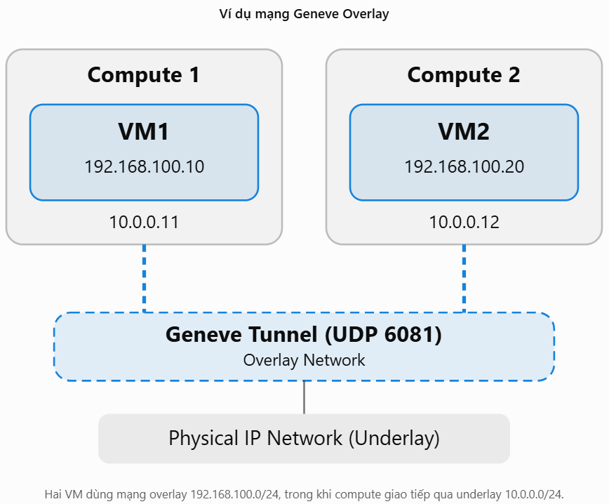
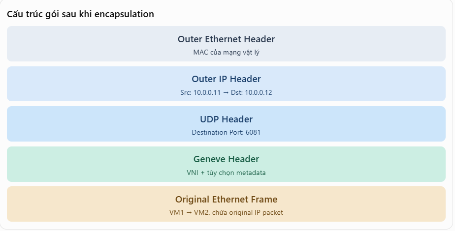

# Network Type
## 1. Geneve
- Generic Network Virtualization Encapsulation là một giao thức đóng gói encapsulation dùng để xây dựng mạng overlay



Khi VM1 gửi packet đến VM2:
- VM1 tạo ethernet frame gửi đến VM2
- Hệ thống mạng ảo trên compute1 xác định VM ở compute 2
- Compute 1 đóng gói Ethernet frame vào Geneve , rồi bọc thêm UDP/IP bên ngoài
- Mạng vật lý chỉ cần chuyển gói từ `10.0.0.11` đến `10.0.0.12`
- Compute 2 tháo Geneve Header và chuyển Ethernet Frame gốc đến VM2

Như vậy, switch vật lý không cần biết địa chỉ `192.168.100.10` hoặc `192.168.100.20`.

Nó chỉ cần biết đường đi giữa hai địa chỉ IP underlay của compute.



Trong Geneve có một trường rất quan trọng: VNI (Virtual Network Identifier), dài 24 bit. Nó giúp phân biệt các mạng Overlay khác nhau.

Những loại Network Type phổ biến:

| Type | Cơ chế | Trường hợp sử dụng |
|------|---------|-----------------------|
| Local | Mạng chỉ tồn tại trên một host | Test, mạng cục bộ |
| Flat | Không gắn VLAN tag cho tenant network | Kết nối trực tiếp mạng vật lý |
| VLAN | Phân tách bằng  802.1Q VLAN tag | Provider Network, kết nối hạ tầng vật lý |
| VXLAN | Overlay qua UDP 4789, dùng VNI | Mạng tenant trên nhiều network |
| Geneve | Overlay qua UDP 6081, hỗ trợ metadata TLV | Phổ biến với OVN/ Openstack|
| GRE | Overlay bằng GRE, dùng tunnel ID | Một số hệ thống legacy

### Phân biệt Geneve và VXLAN

Cả hai đều:
- Tạo mạng Layer 2 overlay trên hạ tầng IP.
- Sử dụng UDP encapsulation.
- Có VNI 24 bit.
- Cho phép VM trên các compute khác nhau giao tiếp cùng mạng logic.

Khác biệt chính:

|	|VXLAN|	Geneve|
|----|------|-----------|
|UDP port mặc định|	4789|	6081|
| Header cơ bản |	8 bytes|	8 bytes|
|Metadata mở rộng|	Hạn chế hơn ở VXLAN cơ bản|	TLV linh hoạt|
|Thiết kế|	Tập trung vào overlay L2 |	Encapsulation mở rộng linh hoạt|
|OpenStack |	ML2/OVS, Linux bridge tùy triển khai|	Thường dùng với OVN|

Geneve không mặc nhiên nhanh hơn VXLAN. Hiệu năng còn phụ thuộc NIC offload, kernel, OVS/OVN, MTU và cấu hình underlay.

### Openstack
- Trong Openstack xem Network type:
```bash
openstack network show <Network_ID> -c provider
```
Xem tunnel:
```bash
ovs-vsctl show 
```
```bash
ovs-vsctl list interface | grep -E \
  'name|type|remote_ip|local_ip'
```