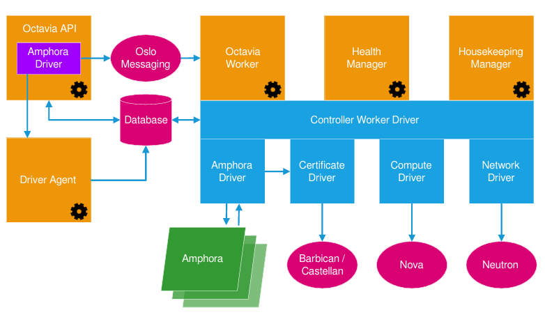

# Tìm hiểu về Octavia
## 1. Khái niệm
Octavia là dịch vụ Load Balancer as a Service (LBaaS) của OpenStack.

Nó cho phép người dùng tạo load balancer qua API hoặc Horizon, giống như tạo một máy ảo hay một mạng, mà không phải tự dựng HAProxy/Nginx bằng tay.

Bài toán nó giải quyết: bạn có nhiều máy chủ chạy cùng một ứng dụng. Cần một “cửa vào” duy nhất (một IP, gọi là VIP) để nhận request và chia đều cho các máy đó, đồng thời tự loại máy nào bị hỏng.

```
Load Balancer (VIP: 10.20.0.50)
   └── Listener (giao thức + cổng, ví dụ TCP/80)
         └── Pool (nhóm backend + thuật toán chia tải)
               ├── Member 1 (10.20.0.80:80)
               ├── Member 2 (10.20.0.81:80)
               └── Health Monitor (kiểm tra sống/chết)
```

| Đối tượng| Vai trò |
|---------|---------------|
| Load Balancer| Vỏ ngoài, giữ VIP (địa chỉ nhận traffic)|
| Listener |	“Lắng nghe” ở một giao thức và cổng, ví dụ HTTP:80|
| Pool |	Tập hợp các backend và thuật toán chia tải (round robin, source IP, least connections...)|
| Member|	Một máy chủ backend cụ thể (IP + cổng)|
| Health Monitor |	Định kỳ kiểm tra member; member lỗi sẽ bị loại khỏi vòng chia tải |
| L7 Policy/Rule |	(tùy provider) định tuyến theo nội dung HTTP như URL, header|

## 2. Kiến trúc và thành phần của Octavia



- **amphorae**- Amphorae are the individual virtual machines, containers, or bare metal servers that
accomplish the delivery of load balancing services to tenant application environments. In Octavia
version 0.8, the reference implementation of the amphorae image is an Ubuntu virtual machine
running HAProxy
- **controller**- The Controller is the "brains" of Octavia. It consists of five sub-components, which
are individual daemons. They can be run on separate back-end infrastructure if desired:
  - **APIController**- As the name implies, this subcomponent runs Octavia’s API. It takes API requests, performs simple sanitizing on them, and ships them off to the controller worker over the Oslo messaging bus.
    - Receives raw requests from users, validates them, and performs initial "sanitization" (cleaning input data, checking syntax, ensuring basic security, and converting the request into a standard, safe internal command format).
    - Nhận các yêu cầu thô (ví dụ: "Tạo cho tôi một máy cân bằng tải mới"). Kiểm tra và làm sạch (Sanitize): Xem xét xem yêu cầu có đúng cú pháp không, có an toàn không, dữ liệu có hợp lệ hay không. Chuyển đơn: Sau khi lọc xong, nó đóng gói lệnh lại thành một định dạng chuẩn và gửi đi qua hệ thống thông tin nội bộ (Oslo messaging bus) để chuyển cho cấp dưới xử lý.
  - **Controller Worker**- This subcomponent takes sanitized API commands from the API controller and performs the actions necessary to fulfill the API request.
    - This is the execution engine. Once the API controller hands off the clean, sanitized command, the Controller Worker takes over to perform the actual heavy lifting—orchestrating workflows, talking to backend drivers, configuring infrastructure (like spinning up load balancer VMs or configuring network ports), and fulfilling the user's request. 
    - Nhận các lệnh đã được làm sạch từ APIController. Làm việc nặng: Tiến hành thực thi toàn bộ công việc chân tay và cấu hình phức tạp. Ví dụ như: điều phối quy trình, gọi các driver phần cứng/phần mềm, tự động tạo máy ảo (VM) làm nhiệm vụ cân bằng tải, cấu hình mạng, cổng kết nối,...
  -  **Health Manager-** This subcomponent monitors individual amphorae to ensure they are up and running, and otherwise healthy. It also handles failover events if amphorae fail unexpectedly.
  -  **Housekeeping Manager**-This subcomponent clean supstale (deleted) database records and manages amphora certificate rotation.
  - **Driver Agent**- The driver agent receives status and statistics updates from provider drivers. Cầu nối cho các provider khác (như OVN), nhận lệnh từ API qua socket
- **network**- Octavia cannot accomplish what it does without manipulating the network environment.
Amphorae are spun up with a network interface on the "load balancer network," and they may also
plug directly into tenant networks to reach back-end pool members, depending on how any given
- **Database (MariaDB)**: Lưu trạng thái mọi load balancer, listener, pool...
- **Message queue (RabbitMQ)**: API gửi tác vụ cho worker/health-manager qua hàng đợi
- **Luồng cơ bản**: người dùng gọi API → API kiểm tra quyền, ghi DB → đẩy tác vụ vào RabbitMQ → worker nhận và thực thi → trạng thái cập nhật trong DB `(PENDING_CREATE → ACTIVE)`.

## 3. Provider: “động cơ” thực sự chia tải
Octavia chỉ là lớp điều khiển; phần thực sự chuyển traffic do provider đảm nhận
- Amphora (provider mặc định, đầy đủ tính năng)
  - Mỗi load balancer = một (hoặc hai) máy ảo chạy HAProxy.
  - Worker dùng Nova tạo VM từ image Amphora, rồi cấu hình HAProxy bên trong qua một agent.
  - Có thể chạy `ACTIVE_STANDBY` (hai VM, một chạy một dự phòng, dùng VRRP/keepalived).
  - Ưu: hỗ trợ L7, kết thúc TLS, nhiều tính năng. Nhược: tốn tài nguyên (mỗi LB một VM), cần mạng quản trị (lb-mgmt-net) và chứng thư riêng.
- OVN 
  - Không tạo VM. Octavia ghi cấu hình load balancer thẳng vào OVN Northbound DB; OVN/OVS thực hiện cân bằng tải ngay trong dataplane mạng ảo.
  - Qua driver-agent (chạy chung pod với API, nói chuyện bằng socket dùng chung).
  - Ưu: nhẹ, nhanh, không tốn VM. Nhược: tính năng hạn chế hơn (chủ yếu L4 TCP/UDP, không có L7 hay kết thúc TLS).

## 4. Hai loại mạng của Octavia
- Mạng tenant (VIP network): nơi VIP và các backend nằm; client truy cập load balancer qua đây.
- Mạng quản trị (lb-mgmt-net): chỉ Amphora cần, để worker/health-manager nói chuyện với các VM Amphora. OVN không cần mạng này.

Octavia = lớp điều khiển (API + DB + hàng đợi) cho load balancer; còn việc chia traffic do provider (Amphora dùng VM HAProxy, OVN dùng luật trong mạng ảo) thực hiện.

## 5. Lưu ý
Với Amphora, việc chia tải do HAProxy chạy bên trong VM làm. Để HAProxy nhận được traffic, gói tin gửi tới VIP phải đến được VM đó và VM phải chấp nhận gói có đích là VIP. Không có VM thì không có tiến trình nào lắng nghe.

VIP gắn vào VM: 
- Chế độ SINGLE (một VM):
  - Port VIP (do Octavia tạo trong Neutron) được gắn trực tiếp vào VM, thường trong một network namespace riêng (`amphora-haproxy`) bên trong VM.
  - Tìm theo IP vẫn thấy được trên port của VM đó.
- Chế độ ACTIVE_STANDBY (hai VM):
  - Mỗi VM có một IP chính riêng (gọi là `vrrp_ip`).
  - VIP là địa chỉ ảo chung, do keepalived/VRRP gán cho VM đang ACTIVE. Khi ACTIVE chết, VIP chuyển sang VM STANDBY.
  - Ở Neutron, VIP được khai báo là allowed address pair trên port của hai VM. Vì vậy `server list` hoặc tìm theo IP chính sẽ không ra VIP; phải tra `vrrp_ip`/`ha_ip` bằng `openstack loadbalancer amphora list`.

Nếu không có VM nào đang giữ IP thì hết cứu 

## 6. Các loại IP trong amphora

Trong amphora list có nhiều IP khác nhau:

| Trường |	Ý nghĩa|
|---------------|----------------------------------|
| `lb_network_ip`| IP trên mạng quản trị lb-mgmt-net|
| `vrrp_ip` |	IP chính của VM trên mạng tenant|
| `ha_ip` |	VIP của LB|

Vì `vrrp_ip` chỉ phục vụ VRRP giữa hai amphora, mà VRRP chỉ có ở Active/Standby, nên với SINGLE trường này nhiều khả năng trống.

`ha_ip` sẽ không được hiển thị trực tiếp trên máy amphora Instance nên bạn có tìm mãi cũng vô ích, bạn chỉ có thể tra cứu được `ha_ip` ở Project -> Network -> Load Balancer đây là nơi sẽ lưu địa chỉ VIP IP còn lại nó không phải IP address của máy Amphora nên bạn k tìm được.

`vrrp_ip` là ip của vm trên mạng tenant cái này đúng nhưng cần hiểu chính xác 1 chút các IP này là các NIC mà Octavia gắn thêm vào amphora sau khi VM đã được tạo ngoài dải mgmt.

| NIC |	Mạng |	Khi nào được gắn|
|----|--------|------------------|
| NIC 1| `lb-mgmt-net`| Lúc boot (theo `amp_boot_network_list`)|
| NIC thuộc mạng VIP | Mạng chứa VIP của LB | Khi LB được tạo/plug VIP|
| NIC thuộc mạng member | Mạng/subnet của từng backend | Khi bạn thêm member ở subnet khác với VIP|

Tức là nếu bạn có LB với VIP ở một mạng và các member ở các mạng khác, amphora sẽ có thêm một NIC cho mỗi mạng đó

Hãy hình dung siêu chill guy:

Giả sử website `www.example.com` chạy trên 2 VM backend, LB có VIP `10.20.0.50`, Floating IP `203.0.113.10`:

```
Người dùng
   │ 1. DNS: www.example.com → 203.0.113.10
   ▼
Floating IP 203.0.113.10
   │ 2. Router tenant DNAT: 203.0.113.10 → 10.20.0.50 (VIP)
   ▼
VIP 10.20.0.50  (nằm trên VM Amphora)
   │ 3. Vào namespace amphora-haproxy trong VM
   ▼
┌──────────────── HAProxy trong Amphora ────────────────┐
│ LISTENER  (frontend)  lắng nghe VIP:443               │
│    │  4. kết thúc TLS, đọc HTTP                       │
│    ▼                                                  │
│ L7 POLICY (tùy chọn)  chọn pool theo URL/header       │
│    ▼                                                  │
│ POOL      (backend)   5. chọn member theo thuật toán  │
│    ▼                                                  │
│ MEMBER    6. tạo kết nối MỚI tới 10.20.0.80:80        │
└───────────────────────────────────────────────────────┘
   ▼
VM backend (web server)  → trả response ngược lại theo đường cũ
```

| Thành phần | Vai trò trong luồng |
|---|---|
| **DNS** | Đưa tên miền về Floating IP |
| **Floating IP + router** | Cổng vào từ bên ngoài; router đổi đích từ Floating IP sang VIP. Floating IP được gắn vào port của VIP |
| **VIP** | Địa chỉ tenant mà amphora giữ, là điểm nhận traffic của LB |
| **Security group của VIP** | Do Octavia quản lý, chỉ mở các cổng của listener (ví dụ 443) |
| **Listener** | "Cửa" của LB: quy định giao thức + cổng (HTTP:80, HTTPS:443, TERMINATED_HTTPS...). Tại đây xử lý TLS (cert từ Barbican), giới hạn kết nối, timeout, danh sách CIDR được phép, chèn header như `X-Forwarded-For` |
| **L7 Policy/Rule** | Tùy chọn: ví dụ `/api` sang pool A, còn lại sang pool B, hoặc redirect HTTP → HTTPS. Một listener có thể chỉ có pool mặc định |
| **Pool** | Nhóm backend và thuật toán chia tải (round robin, least connections, source IP), cùng cấu hình session persistence |
| **Member** | Từng VM backend (IP + cổng) |
| **Health Monitor** | Amphora định kỳ gọi thử (ví dụ `GET /health`); member lỗi bị loại khỏi pool cho đến khi khỏe lại |

- **HAProxy là full proxy: có hai kết nối riêng.** Client nối tới VIP, còn amphora tự mở kết nối khác tới member. Vì vậy VM backend thấy IP nguồn là **IP của amphora**, không phải IP client. Muốn biết IP thật phải đọc header `X-Forwarded-For` (listener HTTP/HTTPS bật được).
- **Mạng mgmt không nằm trong đường đi của traffic.** `lb-mgmt-net` chỉ phục vụ điều khiển: khi bạn tạo listener hay pool, worker đẩy cấu hình HAProxy xuống amphora qua cổng agent (9443), và amphora gửi heartbeat về health manager (UDP 5555). Traffic người dùng chỉ đi qua mạng VIP/member.

Nếu member nằm ở subnet khác VIP, amphora sẽ có thêm NIC trên subnet đó để tới được backend.

## 7. Lệnh Openstack amphora

```bash
openstack loadbalancer amphora list

openstack loadbalancer amphora list -c id -c loadbalancer_id -c role -c status -c lb_network_ip -c ha_ip

openstack loadbalancer amphora list --loadbalancer <lb-id>

openstack loadbalancer amphora list --role MASTER
openstack loadbalancer amphora list --status ERROR

openstack loadbalancer amphora list --compute-id <compute_id>

# Xem chi tiết 1 amphora
openstack loadbalancer amphora show <amphora-id>

# Failover: tạo lại amphora (VM mới thay VM cũ)
openstack loadbalancer amphora failover <amphora_id>

openstack loadbalancer amphora configure <amphora-id>

# Đẩy lại cấu hình xuống amphora (khi cấu hình trên VM bị lệch)
openstack loadbalancer amphora delete <amphora-id>

openstack aggregate show <ID_AGGREGATE>


openstack aggregate set --property evacuable=true <ID_AGGREGATE>


openstack flavor show <FLAVOR_ID> -c properties

openstack aggregate show <ID> -c name -c hosts -c properties