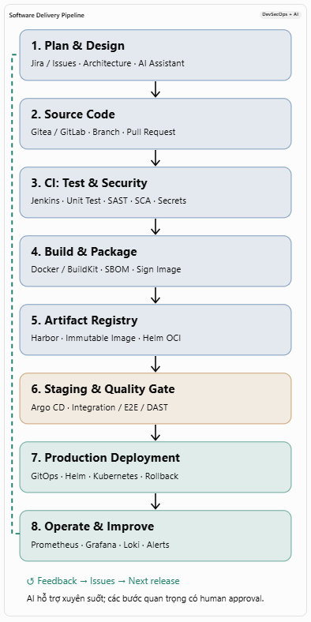
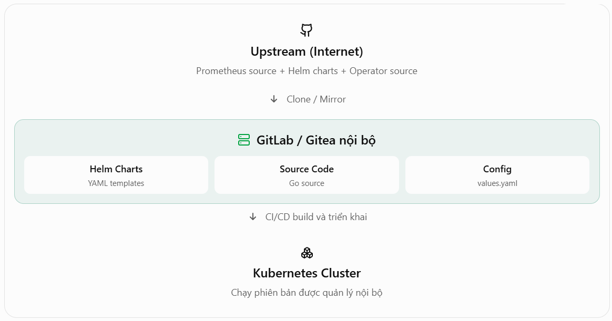

# Git
- CI (Continuous Integration): Kiểm tra code, test, quét bảo mật, build và đóng gói.
- CD (Continuous Delivery/Deployment): Đưa phiên bản đã kiểm chứng qua Staging, phê duyệt và triển khai Production.
- Operations: Theo dõi hệ thống, phát hiện sự cố, rollback và cải tiến liên tục.

## 1. Source Code đến Production Software Delivery Pipeline, DevSecOps + AI



| Giai đoạn      | Công việc chính                | Công cụ                   | AI có thể hỗ trợ                         |
| -------------- | ------------------------------ | ------------------------- | ---------------------------------------- |
| 1. Planning    | Yêu cầu, thiết kế, chia task   | Jira, GitLab Issues       | Viết user stories, phân tích yêu cầu     |
| 2. Coding      | Viết source, commit, PR        | Git, Gitea, VS Code       | Sinh code, refactor, giải thích code     |
| 3. Code Review | Kiểm tra chất lượng code       | Gitea/GitLab, SonarQube   | Review PR, phát hiện lỗi logic           |
| 4. CI Testing  | Unit test, integration test    | Jenkins, pytest, JUnit    | Sinh test cases, phân tích test failures |
| 5. Security    | SAST, SCA, secret scanning     | Semgrep, Trivy, Gitleaks  | Phân tích lỗ hổng, đề xuất remediation   |
| 6. Build       | Build binary/container image   | Docker, BuildKit          | Tối ưu Dockerfile, phân tích lỗi build   |
| 7. Registry    | Lưu image và artifacts         | Harbor, Nexus             | Phân tích dependency risk                |
| 8. Staging     | Deploy, E2E, performance test  | Kubernetes, Argo CD, k6   | Sinh kịch bản test, phân tích hiệu năng  |
| 9. Production  | Deploy, canary, rollback       | Argo CD, Helm, Kubernetes | Đánh giá rủi ro triển khai               |
| 10. Operations | Monitoring, alerting, incident | Prometheus, Grafana, Loki | Phân tích log, hỗ trợ RCA                |

### Những cổng kiểm soát trước khi lên Production

Không nên cứ `git push` là tự động lên Production ngay.

- **Quality Gate**: Unit tests, integration tests, lint và kiểm tra code phải đạt

- **Security Gate**: Không có lỗ hổng vượt ngưỡng chấp nhận; secrets không bị lộ

- **Artifact Gate**: Image đã quét, có digest, provenance và SBOM theo chính sách

- **Staging Gate**: E2E, performance và smoke tests đạt; database migration đã được kiểm tra

- **Release Approval**: Có phê duyệt khi cần, kế hoạch rollback và quan sát sau triển khai

## 3. Ví dụ thực tế: Developer sửa một API

Giả sử công ty bạn có ứng dụng `payment-api` đang chạy trên Kubernetes.

### Bước A — Developer sửa code

```
git checkout -b feature/payment-v2
git add .
git commit -m "Add payment validation"
git push origin feature/payment-v2
```

Developer mở Pull Request vào nhánh `main`.

AI hỗ trợ: Viết unit tests, giải thích code, đề xuất cải tiến và tóm tắt PR. Nhưng code vẫn phải được người có trách nhiệm review.

### Bước B — Jenkins CI tự động chạy

Jenkins Pipeline

Checkout

Lint + Unit Tests

SAST + Dependency Scan

Build + Container Scan

Push to Harbor

Minh họa pipeline thành công, không phải kết quả thực thi thực tế.

Nếu bất kỳ quality gate bắt buộc nào thất bại, pipeline dừng.

### Bước C — Build và lưu image

Sau khi PR được duyệt và merge, CI build image từ commit đã xác định:

```
docker build -t harbor.internal/apps/payment-api:v2 .
docker push harbor.internal/apps/payment-api:v2
```

Trong production nên triển khai bằng image digest bất biến (`sha256:...`) thay vì chỉ tin vào tag `v2`.

### Bước D — GitOps triển khai

CI cập nhật repository cấu hình môi trường, ví dụ:

```
image:
  repository: harbor.internal/apps/payment-api
  digest: sha256:...
```

Argo CD quan sát GitOps repository và đồng bộ manifests xuống Kubernetes theo chính sách. Bạn có thể dùng Helm chart để render các manifests đó.

Một điểm quan trọng: Argo CD không phải Operator quản lý logic nội bộ của ứng dụng. Nó là GitOps controller đồng bộ trạng thái Kubernetes với Git.

### Bước E — Giám sát sau deploy

Prometheus thu thập metrics, Grafana hiển thị dashboard, Loki lưu log, Alertmanager gửi cảnh báo.

Ví dụ khi deploy bản mới:

- Error rate tăng mạnh.
- P95 latency vượt ngưỡng.
- Pod restart liên tục.

Hệ thống cảnh báo; automation có thể tạm dừng rollout hoặc rollback theo chính sách đã kiểm thử. AI có thể phân tích logs, metrics và các thay đổi gần nhất để đề xuất nguyên nhân.

Không nên để AI tự ý sửa Production hoặc chạy lệnh phá hủy mà không có cơ chế phê duyệt và giới hạn quyền.

## 4. Kiến trúc triển khai thực tế trên hạ tầng OpenStack

Nếu bạn có hạ tầng OpenStack, có thể chia thành các VM hoặc cụm dịch vụ như sau:

Self-hosted DevSecOps Platform

Git Server

Gitea / GitLab

Source + GitOps repos

CI Server

Jenkins + Agents

Test + Scan + Build

Registry

Harbor

Images + Helm OCI

AI Services

LLM Gateway + RAG

Code review + log analysis

Kubernetes — Staging

Argo CD · Helm · Test Workloads · E2E

Release promotion + approval

Kubernetes — Production

Argo CD · Ingress · Application · Database

RBAC, NetworkPolicy, Secrets, Backups

Observability & Security

Prometheus · Grafana · Loki · Alertmanager

Metrics, logs, traces, incident response

Trong production thực tế, bạn còn cần thiết kế HA, backup/restore, quản lý secrets, phân quyền, network isolation và disaster recovery. Các VM trong sơ đồ là phân chia logic, không bắt buộc mỗi dịch vụ phải có một VM riêng.

## 5. Git Server
- [Gitea](https://about.gitea.com/)
- [Forgejo](https://forgejo.org/)
- [GitLab Self-Managed](https://about.gitlab.com/install)
- [Gerrit Code Review](https://www.gerritcodereview.com)

Mô hình triển khai



### Docker
Docker Engine hiện là dự án mã nguồn mở tên Moby, viết bằng Go.
- Source: `github.com/moby/moby`
- Build: cần Go toolchain, thường build bằng chính container (`make binary` hoặc dùng `hack/make.sh`)
- Sau khi sửa code Go, build ra binary `dockerd`, `docker` (CLI đôi khi là repo riêng `docker/cli`)
- Đóng gói lại thành `.deb`/`.rpm` bằng công cụ có sẵn trong repo (`hack/make/`, hoặc dùng `nfpm`,`fpm`)
- Host package đó lên repo apt/yum nội bộ (ví dụ Aptly, Pulp, hoặc Nexus/Artifactory) rồi trỏ máy client vào đó thay vì `dowload.docker.com`

### 1.2 Kubernetes (K8s)
K8s cũng viết bằng Go, source tại `github.com/kubernetes/kubernetes`, cực lớn (nhiều component: kube-apiserver, kube-scheduler, kubelet, kube-controller-manager...).
- Build bằng `make`(dùng script `build/` có sẵn, build trong container để đảm bảo môi trường đồng nhất)
- Sau khi sửa, build ra các binary hoặc build container image riêng cho từng component (K8s control plane chạy dạng container image, không phải chỉ package hệ điều hành)
- Push image build lại lên private container registry (Harbor, ECR, GCR nội bộ...)
- Trong manifest/Helm chart, trỏ image field về registry nội bộ đó thay vì `registry.k8s.io`

Nhiều công ty còn tạo fork riêng trên GitHub, giữ đồng bộ với upstream bằng cách rebase/merge định kỳ, để dễ quản lý patch.

### 1.3 OpenStack
- Source từng service nằm ở opendev.org/openstack/<tên-service> (OpenStack dùng Gerrit + OpenDev, không chỉ GitHub)
- Vì là Python, "build" chủ yếu là đóng gói (`pip`/`setuptools`, tạo wheel) chứ không compile
- Sửa code Python trực tiếp, sau đó:
  - Đóng gói thành package riêng (deb qua debuild, hoặc rpm qua rpmbuild/tox) rồi đưa vào repo nội bộ
  - Hoặc dùng công cụ triển khai như Kolla-Ansible/Kolla, build container image cho từng service OpenStack, sửa code rồi build lại image, đẩy lên registry nội bộ
  - Hoặc đơn giản deploy trực tiếp bằng virtualenv/pip từ git clone (ít phổ biến ở production nhưng dùng nhiều lúc dev/test)

### 1.4 Điểm chung hạ tầng
- **Internal package/artifact repository**: Nexus, Artifactory, Pulp, Aptly (cho deb/rpm), Harbor (cho container image)
- **CI/CD pipeline**: tự build lại từ source mỗi khi có patch (Jenkins, GitLab CI, GitHub Actions self-hosted)
- **Fork + patch management**: giữ nhánh riêng, theo dõi upstream, có quy trình rebase để không bị lệch quá xa bản gốc (tránh "patch địa ngục" khi upstream update)
- **Versioning riêng**: để phân biệt bản gốc và bản đã patch (ví dụ `1.28.3-company.2`)

### 1.5 3 kiểu lưu trữ

| Loại | Dùng cho | Ví dụ công cụ | Client download |
|------|----------|---------------|-----------------|
| Package repo | deb/rpm(Openstack, binary Linux) | Apply, Pulp, Nexus | `apt/dnf`|
| Container registry | image (Docker, K8s) | Harbor, Artifactory | `docker pull`, `kubectl` qua manifest |
| Git nội bộ | source code, không phải để cài | Gitlab, Gitea | `git clone` (dành cho dev, không phải server production)|

### 1.6 Cơ chế Git: Branch và Tag
Một repo Git không chỉ có 1 dòng code — nó là một cây lịch sử với nhiều nhánh rẽ ra tại các thời điểm khác nhau.
```
main/master  ●───●───●───●───●───●──→ (code mới nhất, đang phát triển)
              \       \
               \       ●───●  stable/2025.2 (nhánh đóng băng tại 1 thời điểm)
                \
                 ●───●───●  stable/2025.1 (nhánh cũ hơn, chỉ nhận bugfix/security patch)
```
- Cách check trên CLI:
```bash
# Clone về, mặc định checkout nhánh main
git clone https://opendev.org/openstack/nova.git
cd nova

# Xem tất cả các nhánh có trên remote
git branch -r
# origin/stable/2025.1
# origin/stable/2025.2
# origin/stable/2026.1
# origin/unmaintained/2024.1
# ...

# Muốn build bản 2025.2 → chuyển sang nhánh đó
git checkout stable/2025.2

# Hoặc muốn đúng 1 bản vá cụ thể → checkout theo tag
git checkout tags/32.0.0    # tương ứng OpenStack 2025.2 (Nova 32.0.0)
```
- Khi CI/CD của công ty build, họ sẽ chỉ định rõ checkout nhánh/tag nào, ví dụ trong pipeline:
```bash
# ví dụ đơn giản hoá 1 job CI
- git clone https://opendev.org/openstack/nova.git
- git checkout stable/2025.2      # chốt đúng phiên bản cần patch
- git apply company-patches/*.patch   # áp patch riêng của công ty
- build & test
- push package/image gắn tag: nova-2025.2-company.1
```
Nghĩa là công ty không tự tạo phiên bản 2025.1/2025.2 — những nhánh đó do cộng đồng OpenStack quản lý sẵn trên OpenDev. Việc của công ty là chọn đúng nhánh/tag làm điểm xuất phát, rồi áp patch riêng lên trên, và tự đặt version string riêng cho bản build của mình để phân biệt với bản gốc (ví dụ hậu tố `-company.1` như trên).

Cùng logic này áp dụng cho Docker (Moby) và Kubernetes — cả hai đều có nhánh `release-x.y` (K8s) hoặc tag theo semver, bạn có muốn mình show ví dụ cụ thể branching của Kubernetes không (nó hơi khác vì K8s dùng semver `vX.Y.Z` thay vì tên cycle)?

### OpenStack SDK và Source Code
| | OpenStack SDK | Git+ sửa source |
|--|-------------|-----------------|
| Người dùng | Dùng OpenStack (đã có sẵn, chạy rồi) | Đội ngũ vận hành/ phát triển hạ tầng |
| Vai trò | Ứng dụng Client / bên ngoài | Đội ngũ vận hành/ phát triển hạ tầng |
| Ví dụ việc làm | Viết script tạo VM, quản lý network, tự động hoá | Thêm tính năng mới cho Nova, sửa bug trong Neutron |
| Chạy ở đâu | Trong ứng dụng của bạn, gọi API ra ngoài | Là chính service OpenStack đang chạy trên control plane|

- Nói đơn giản: SDK là để nói chuyện VỚI OpenStack, git clone là để sửa CHÍNH OpenStack.

#### Khi nào dùng OpenStack SDK
SDK (`openstacksdk`, viết bằng Python — package `pip install openstacksdk`) dùng khi bạn là người dùng cuối của cụm OpenStack đã chạy sẵn, muốn:
- Viết script tự động tạo/xoá VM, volume, network
- Tích hợp OpenStack vào hệ thống nội bộ (ví dụ: portal tự cấp phát server cho dev)
- Build công cụ quản trị, dashboard riêng
- Terraform provider cho OpenStack cũng dùng cơ chế tương tự (gọi REST API)

```python
import openstack

conn = openstack.connect(cloud='mycloud')
server = conn.compute.create_server(
    name='my-vm', image_id=..., flavor_id=..., networks=[...]
)
```
Ở đây bạn không đụng vào source code Nova/Neutron/Cinder gì cả. Cụm OpenStack có thể do team hạ tầng dựng sẵn (dù là bản gốc hay bản đã customize), bạn chỉ gọi API vào nó thôi. Đây là công việc của application developer / DevOps tự động hoá.

#### Khi nào git clone + sửa code
Chỉ khi bạn cần thay đổi hành vi/tính năng của chính service OpenStack:
- Nova hiện không hỗ trợ 1 loại scheduler filter mà công ty cần → phải sửa code Nova
- Cần thêm 1 API endpoint riêng không có trong OpenStack gốc
- Fix 1 bug ảnh hưởng công ty nhưng upstream chưa release patch

### Nguyên tắc chung
- **Clone source code** từ Git repo chính thức (GitHub/GitLab/Gerrit...)
- **Build từ source** thay vì tải binary/package
- **Sửa code**, test lại
- **Đóng gói lại** thành package riêng (deb/rpm/image/binary) hoặc chạy trực tiếp từ source
- **Deploy bản custom** đó thay cho bản chính thức, thường qua **private repo/registry** nội bộ
