# CRD và sử dụng Operator có sẵn
* Trong hệ sinh thái Kubernetes Operator, Operand là thuật ngữ dùng để chỉ ứng dụng, dịch vụ hoặc phần mềm cốt lõi mà một Operator đang quản lý, tự động hóa và vận hành.
* Reconciling là quá trình Operator liên tục kiểm tra, so sánh và điều chỉnh để đưa trạng thái thực tế của hệ thống về đúng với trạng thái mong muốn mà bạn đã định nghĩa.
## 0. Vấn đề

K8s có sẵn các đối tượng như Pod, Deployment, Service. Với app đơn giản (web stateless) thế là đủ: bạn nói "chạy 3 bản", K8s giữ đúng 3 bản, chết một cái thì tạo cái mới.

Nhưng với thứ phức tạp như một cụm database thì không đủ. Chạy MySQL có primary và replica thì cần: ai là primary, replica phải sync từ đâu, primary chết thì chọn replica nào lên thay, backup lúc nào, nâng version thế nào mà không mất dữ liệu. K8s gốc không biết những chuyện này, trước giờ phải có một DBA làm tay.

Operator là cách viết kinh nghiệm của DBA đó thành phần mềm chạy trong K8s.

Controller: bộ phận làm việc
1. Xem trạng thái MONG MUỐN là gì (bạn khai báo)
2. Xem trạng thái THỰC TẾ đang ra sao
3. Lệch thì sửa cho khớp
4. Quay lại bước 1

CRD và CR: ngôn ngữ để nói chuyện với operator

K8s chỉ hiểu Pod, Service... Muốn khai báo "tôi muốn một cụm Postgres 3 node" thì phải dạy K8s một loại đối tượng mới. Hai khái niệm trong đoạn bạn đọc là:
- CRD (Custom Resource Definition): bản định nghĩa loại đối tượng mới. Giống khai báo "bảng" trong database hoặc "class" trong lập trình: quy định có những trường nào (số node, version, dung lượng...), kiểu gì, giá trị nào hợp lệ.
- CR (Custom Resource): một bản ghi cụ thể theo định nghĩa đó. Giống một dòng trong bảng, hoặc một object tạo từ class.


### Cần phân biệt

Câu hỏi này rất hay vì StatefulSet và Operator đều có khả năng duy trì trạng thái mong muốn (desired state), nhưng chúng giải quyết hai vấn đề khác nhau.
- StatefulSet: Quản lý vòng đời Pod và danh tính ổn định của Pod.
- Operator: Quản lý vòng đời và logic vận hành của cả ứng dụng, đặc biệt là các ứng dụng phức tạp như Database, Kafka, Elasticsearch.
- Ví dụ: Bạn triển khai Postgre SQL với 3 Pod

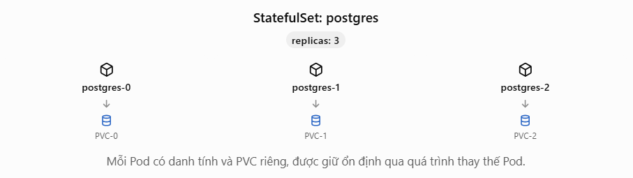

StatefulSet đảm bảo:
- **Stable Pod Identity**: `postgres-0` bị xóa thì Kubernetes tạo lại Pod với cùng tên.
- **Stable Storage**: Pod mới có thể gắn lại PVC tương ứng.
- **Ordered Deployment**: Có thể tạo, xóa và cập nhật Pod theo thứ tự.
- **Self-healing**: Pod bị lỗi hoặc biến mất thì Kubernetes cố gắng đưa số Pod về đúng replicas.

Nhưng có một vấn đề rất lớn: StatefulSet không hiểu PostgreSQL hoạt động như thế nào.
- Replica nào có dữ liệu mới nhất?, Có nên promote `postgres-1` thành Primary không? Làm sao tránh hai Primary cùng ghi dữ liệu (split-brain)? Làm sao cấu hình replication lại sau failover? Làm sao tránh hai Primary cùng ghi dữ liệu (split-brain)? Làm sao cấu hình replication lại sau failover?

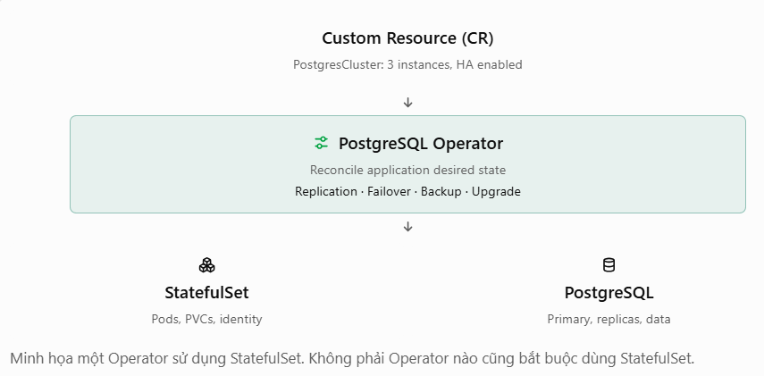

## 1. Khái niệm
Operator là một ứng dụng chạy liên tục, theo dõi K8s API và thực hiện logic vận hành. Phần lớn operator viết bằng Go vì chính K8s viết bằng Go, nên có sẵn thư viện tốt: `client-go`, `controller-runtime`, và bộ khung Kubebuilder / Operator SDK sinh sẵn mã nguồn.

Ví dụ: Rook, cert-manager, Prometheus Operator, Kube-OVN đều là Go. Ngôn ngữ khác cũng làm được: Java (Strimzi cho Kafka), Python (kopf), Rust (kube-rs).

| Lớp	 | Dùng gì |
|-----|-----------|
| Logic vận hành (bộ não) |	Go (phổ biến nhất), hoặc Java/Python/Rust; Helm/Ansible cho trường hợp đơn giản|
| Cài operator vào cluster |	YAML, Helm, hoặc OLM |
| Người dùng khai báo ứng dụng |	YAML (CR)|


Kubernetes Operator là một bộ điều khiển (controller) đặc biệt giúp tự động hóa vòng đời và quản lý ứng dụng hoặc dịch vụ phức tạp trên nền tảng Kubernetes.

Operator hoạt động như một tiện ích mở rộng của phần mềm, tận dụng kiến thức chuyên môn của con người để tự động hóa việc quản lý các ứng dụng phức tạp. 

Về mặt kỹ thuật, Operator là một bộ điều khiển tùy chỉnh (Custom Controller) sử dụng các định nghĩa tài nguyên tùy chỉnh (Custom Resource) để quản lý các ứng dụng và các thành phần của chúng theo cách tự động hóa.

Mỗi operator thường gồm nhiều controller, với từng controller phụ trách một nhóm resource và nhiệm vụ liên quan đến ứng dụng mục tiêu. Operator cho phép chuyển hóa kiến thức vận hành và quy trình thủ công thành logic phần mềm, giúp triển khai, quản lý, backup và restore ứng dụng phức tạp trên Kubernetes một cách tự động và nhất quán. Nhờ đó, việc quản trị lifecycle các ứng dụng như database hay message broker được tối ưu hóa và tự động hóa hoàn toàn qua Kubernetes API và kubectl.

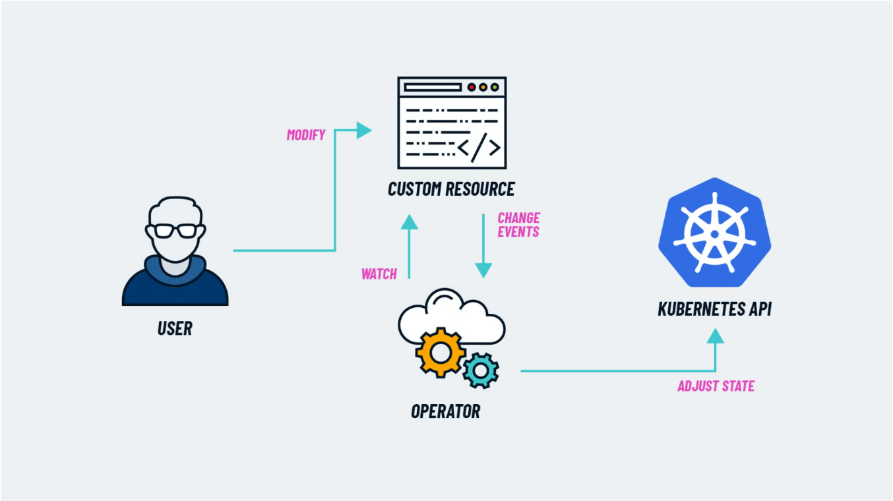

## 2. Kiến trúc Kubernetes Operator
A Kubernetes cluster treats an operator like an application that's deployed as a workload. This specialized application manages another resource, such as another application hosted in Kubernetes.

An operator manages an operand using a set of managed resources:
- Operand: The managed resource that the operator provides as a service.
- Managed resources: The Kubernetes objects that an operator uses to create the operand.

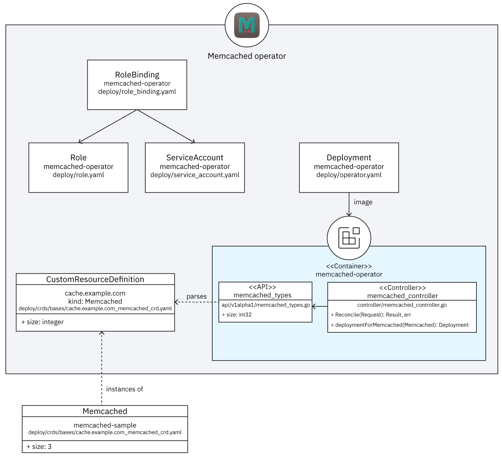

### 2.1 Custom Resource 
Custom Resource là định nghĩa về tài nguyên mới được thêm vào API của Kubernetes (ví dụ: MySQLCluster, KafkaTopic). CR cho phép người dùng khai báo “trạng thái mong muốn” của dịch vụ thay vì chỉ sử dụng các tài nguyên mặc định như Pod hay Service. Nhờ CR, việc quản lý các ứng dụng phức tạp có thể được mô tả thống nhất bằng YAML/manifest.

### 2.2 Custom Resource Definition
Custom Resource Definition là bản thiết kế mô tả cấu trúc và quy tắc dữ liệu cho CR. Khi CRD được áp dụng, Kubernetes sẽ hiểu rằng có một loại API mới và cho phép người dùng tạo các đối tượng dựa trên định nghĩa này. CRD quy định các trường, kiểu dữ liệu, validation và có thể tích hợp với cơ chế kiểm tra dữ liệu đầu vào. Nhờ đó, Custom Resource được Kubernetes nhận diện và xử lý như một loại tài nguyên chuẩn trong hệ thống.

Giả sử Kubernetes là một hệ thống quản lý nhân sự.
- CRD = Mẫu đơn đăng ký nhân viên: Quy định đơn phải có những trường nào, kiểu dữ liệu ra sao.
- CR = Một đơn đăng ký cụ thể: Nguyễn Văn A, 25 tuổi, vị trí DevOps.
- Operator = Người xử lý đơn: Đọc thông tin, thực hiện công việc cần thiết và theo dõi kết quả.

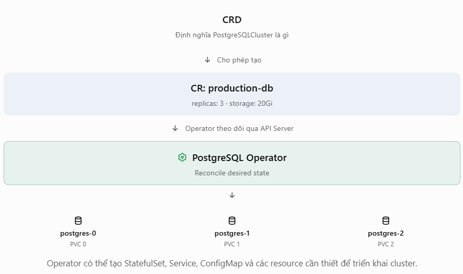

CRD defines a schema of settings available for configuring the operand.

| Thành phần có sẵn |	Kết quả |
|---------------------|------------|
| Chỉ có CRD |	Kubernetes biết loại resource mới|
| Có CRD + CR |	Kubernetes lưu được cấu hình của resource mới|
| Có CRD + CR + Operator |	Operator có thể đọc cấu hình và thực hiện logic tạo, quản lý ứng dụng|

### 2.3 Programmatic API
Defines the same data schema as the CRD and is implemented using the operator’s programming language, such as Go.

### 2.4 Controller
The brains of the operator. The controller creates managed resources based on the description in the custom resource; controllers are implemented using the operator’s programming language, such as Go.

### 2.5 Role and service accounts

Kubernetes role-based access control (RBAC) resources with permissions that allow the controller to create the managed resources.

## 3. Deploying workloads in Kubernetes

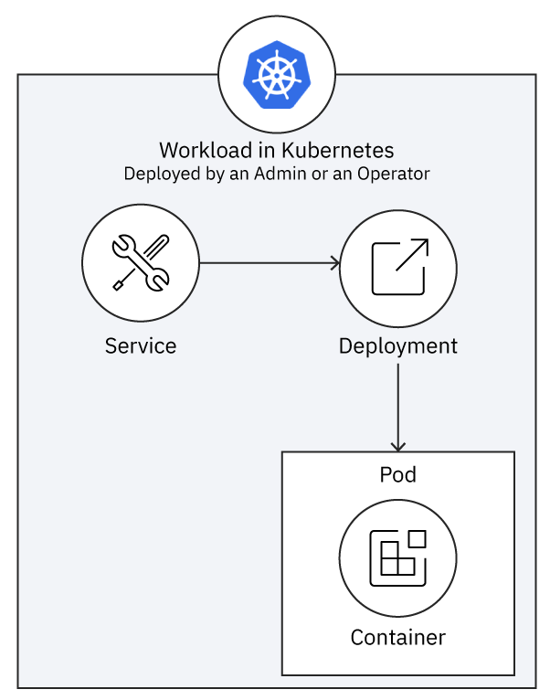

The workload consists of a Deployment that runs a set of Pod replicas, each of which runs a duplicate Container. The Deployment is exposed as a Service, which provides a single fixed endpoint for clients to invoke behavior in the set of replicas.

An operator deploys a workload in very much the same way that a human administrator (or a build pipeline) does.

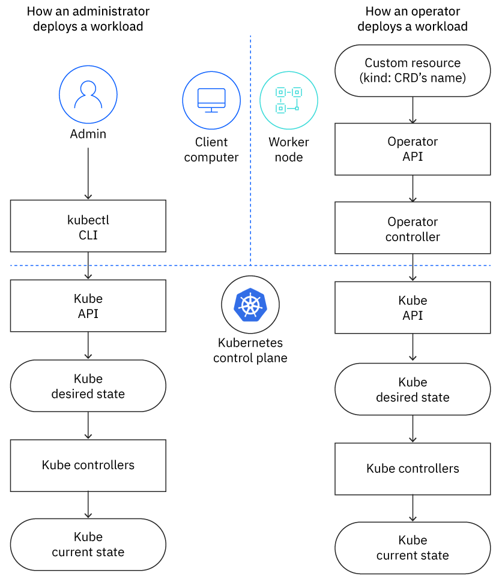

- The CR acts like the administrator's YAML file, providing an abstract description of the resource that should be deployed.
- The controller uses its API to read the CR and uses the Kubernetes API to create the resource described by the CR, much like an admin running kubectl commands.

The Kubernetes API doesn't know whether its client is an admin using client tools or an operator running a controller. Either way, it performs the client's commands by updating the desired state, which Kubernetes' controllers use to update the current state. In this way, the operator does what the admin would do, but in an automated way that's encapsulated in its controller's implementation.

## 4. Reconciliation loop

In Kubernetes Operators, controllers manage a cluster’s state, reconciling the current state to match the desired state. Kubernetes controllers run in the control plane.

the control loop in the controller manager is a reconciliation loop

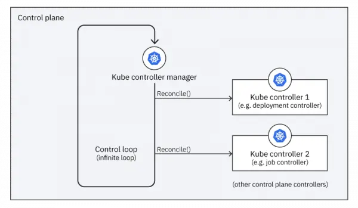

Each operator extends the reconciliation loop by adding its custom controller to the controller manager's list of controllers

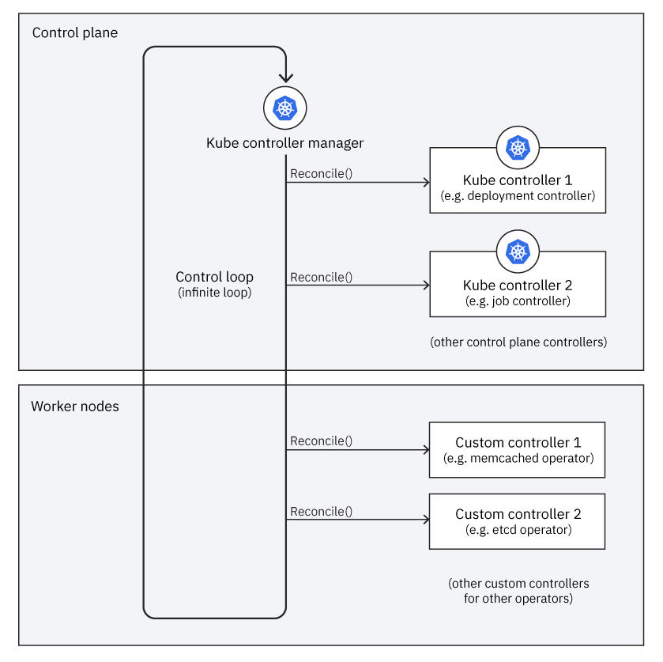

- When the controller manager runs the reconciliation loop, it does two things:
  - Tells each controller in the control plane to reconcile itself.
  - Tells each operator’s custom controller to reconcile itself.

 the relationship between a cluster's desired state and its current state and how a controller reconciles between those two states for the resources it manages.

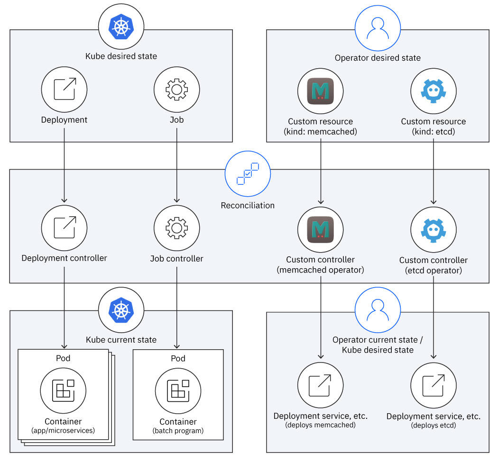

## 5. Lab: tạo `ServiceMonitor` để Operator xử lý

Yêu cầu: `kubectl`, Helm, quyền cài CRD/RBAC toàn cluster, cluster có internet và đủ tài nguyên. Dùng Bash. Kiểm tra context trước vì chart tạo nhiều resource:

```bash
kubectl config current-context
kubectl create namespace operator-lab
helm repo add prometheus-community https://prometheus-community.github.io/helm-charts
helm repo update
helm install monitor prometheus-community/kube-prometheus-stack -n operator-lab --set grafana.enabled=false
kubectl -n operator-lab get pods
kubectl get crd | grep monitoring.coreos.com
kubectl api-resources --api-group=monitoring.coreos.com
kubectl -n operator-lab get prometheus,servicemonitors
```

Đợi Operator và Prometheus chạy. Kiểm tra selector của Prometheus:

```bash
kubectl -n operator-lab get prometheus -o yaml | grep -A8 serviceMonitorSelector
```

Chart thường cấu hình selector theo release label `release: monitor`. Tạo Service có metrics giả lập và ServiceMonitor có nhãn đó:

```bash
kubectl -n operator-lab create deployment metrics-demo --image=nginx:1.27
kubectl -n operator-lab expose deployment metrics-demo --port=80 --target-port=80 --name=metrics-demo
kubectl -n operator-lab label service metrics-demo app=metrics-demo
kubectl -n operator-lab apply -f - <<'EOF'
apiVersion: monitoring.coreos.com/v1
kind: ServiceMonitor
metadata:
  name: metrics-demo
  labels:
    release: monitor
spec:
  selector:
    matchLabels:
      app: metrics-demo
  endpoints:
  - port: http
    path: /
    interval: 30s
EOF
```

`ServiceMonitor.spec.endpoints[].port` phải là **tên port của Service**. Lệnh `kubectl expose` có thể tạo port chưa được đặt tên; đặt tên rõ ràng:

```bash
kubectl -n operator-lab patch service metrics-demo --type=json -p '[{"op":"add","path":"/spec/ports/0/name","value":"http"}]'
kubectl -n operator-lab get servicemonitor metrics-demo -o yaml
kubectl -n operator-lab get service metrics-demo -o yaml
```

Quan sát CR được API server lưu; Operator sẽ đưa cấu hình scrape vào Prometheus nếu selector khớp. Endpoint nginx `/` **không xuất Prometheus metrics**, vì vậy target có thể báo parse error; điều đó vẫn chứng minh discovery và reconciliation nhưng chưa phải monitoring ứng dụng đúng. Để kiểm tra đầy đủ, thay Deployment bằng ứng dụng có endpoint `/metrics` và đổi `path` trong CR. Nếu target không xuất hiện, kiểm tra label của ServiceMonitor so với `serviceMonitorSelector`, label Service so với `spec.selector`, namespace selector, tên port và log của Operator:

```bash
kubectl -n operator-lab get pods | grep operator
kubectl -n operator-lab describe servicemonitor metrics-demo
```

- Service Monitor chính là 1 CR điển hình

## Tự kiểm tra

1. Vì sao chỉ có CRD mà không có controller thì `ServiceMonitor` không tạo cấu hình scrape?
2. Label `release: monitor` và `app: metrics-demo` được dùng ở hai selector nào?
3. Khi sửa CR, ai đưa trạng thái thực về trạng thái mong muốn?

## Dọn lab

```bash
helm uninstall monitor -n operator-lab
kubectl delete namespace operator-lab
```

Chart có thể giữ CRD sau `helm uninstall`; chỉ xóa CRD trên cluster lab riêng khi chắc chắn không có release/CR nào khác phụ thuộc.

## 6. Control Loop

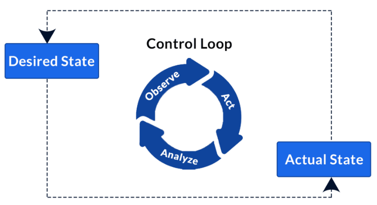

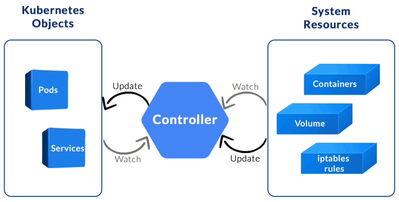

Operator là một phần mềm (Custom Controller) chạy trong Kubernetes, có nhiệm vụ tự động quản lý và vận hành một ứng dụng dựa trên trạng thái mong muốn (Desired State).

Operator giống như một System Admin tự động, biết ứng dụng phải hoạt động như thế nào và cần làm gì khi có sự cố.

Operator sẽ:
1. Deploy: Tạo và cấu hình PostgreSQL Cluster gồm 3 instance.
2. Monitor: Theo dõi tình trạng cluster.
3. Self-healing: Phát hiện sự cố và thực hiện khôi phục theo logic ứng dụng.
4. Failover: Có thể tự động chọn Primary mới khi Primary cũ gặp sự cố.
5. Reconcile: Liên tục đưa trạng thái thực tế về trạng thái mong muốn.

Các chức năng cụ thể phụ thuộc vào từng Operator.

- Nếu muốn tự triển khai 1 Operator:

Bạn thường sẽ:
1. Viết CRD để định nghĩa loại resource mới.
2. Viết code Go/Python xử lý logic reconcile.
3. Đóng gói code thành container image.
4. Tạo Deployment, RBAC và các tài nguyên cần thiết để chạy Operator trong Kubernetes.
5. Tạo CR để yêu cầu Operator thực hiện công việc.

CRD là định nghĩa, CR là yêu cầu, Operator là chương trình thực hiện yêu cầu.

## 7. Giải thích ngoài lề
Prometheus Operator không trực tiếp đi lấy metrics. Nó quản lý Prometheus, còn Prometheus mới là thành phần thực hiện scrape.

Scrape = Prometheus chủ động đi “hỏi” ứng dụng xem số liệu hiện tại là gì, rồi lưu lại.

Cách hoạt động giống như một người đi đọc đồng hồ điện:
- Cứ mỗi 30 giây, Prometheus gửi một request GET http://<địa-chỉ-app>:80/metrics, đọc kết quả, lưu kèm mốc thời gian.
- Sau một thời gian, bạn có biểu đồ: “10:00 có 1000 request, 10:01 có 1500 request...”

Hành động “gửi request lấy số liệu” đó gọi là scrape (nghĩa đen: cạo/gom). Đây là mô hình pull: Prometheus đi lấy, ứng dụng không tự đẩy số liệu đi.

Đoạn ServiceMonitor mục đích nói với Prometheus hãy đi scrape ứng dụng này mà không phải tự viết scrape config.

Đoạn này chính là Custom Resource:

- Ai được phép đọc:
```yaml
metadata:
  labels:
    release: monitor
```
- Giám sát ứng dụng nào:
```yaml
spec:
  selector:
    matchLabels:
      app: metrics-demo
```
- Scrape như thế nào:
```yaml
  endpoints:
  - port: http
    path: /
    interval: 30s
```
```
ServiceMonitor  ──(selector app=metrics-demo)──►  Service metrics-demo  ──►  Pod nginx
   (đơn khai báo)                                   (port tên "http")
        │
        ▼
Operator đọc đơn, tự sinh scrape config, nạp vào Prometheus
        │
        ▼
Prometheus cứ 30s gửi GET http://<IP-pod>:80/ để lấy số liệu
```

## 8. Lưu ý phân biệt
- Mỗi dịch vụ đặc thù có 1 Operator riêng, Nên nhớ Operator chỉ là 1 phần tích hợp nhỏ đc viết bằng ngôn ngữ Go. 
- Prometheus, PostgreSQL và MariaDB thường cần các Operator khác nhau, bởi vì logic vận hành của ba hệ thống này hoàn toàn khác nhau.

|| Prometheus Operator |	PostgreSQL Operator|	MariaDB Operator|
|-------|---------------|--------------------|-------------------|
| CR điển hình |	ServiceMonitor, Prometheus |	PostgresCluster	MariaDB |
| Nhiệm vụ |	Quản lý Prometheus và cấu hình scrape |	Quản lý PostgreSQL cluster |	Quản lý MariaDB cluster|
| Scale|	Điều chỉnh Prometheus instances/replicas|	Thêm PostgreSQL replicas|	Thêm MariaDB replicas|
| Xử lý lỗi |	Phục hồi cấu hình và thành phần monitoring|	Phối hợp phục hồi, failover PostgreSQL |	Phối hợp phục hồi, failover MariaDB |
| Logic đặc thù |	Service discovery, scrape configuration|	WAL, replication, Patroni|	Replication, Galera hoặc cơ chế HA tùy triển khai|

- Vì thế, bạn không thể lấy logic của Prometheus Operator để quản lý PostgreSQL.

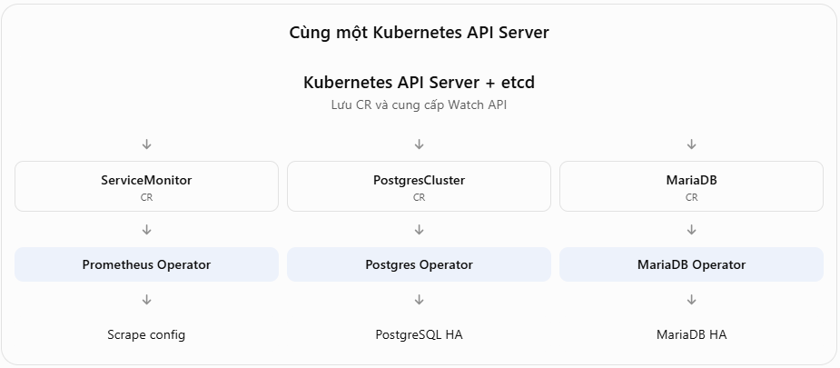

Cả ba đều thực hiện một quy trình chung:
1. Watch: Theo dõi tài nguyên liên quan thông qua Kubernetes API.
2. Compare: Xác định sự khác biệt giữa trạng thái mong muốn và trạng thái thực tế.
3. Reconcile: Tạo, sửa, xóa tài nguyên hoặc thực hiện logic chuyên biệt để thu hẹp sự khác biệt.
4. Repeat: Tiếp tục reconcile khi có sự kiện hoặc cần kiểm tra lại.

Cơ chế chung giống nhau, nhưng logic bên trong khác nhau.

Ví dụ muốn chạy MariaDB, bạn có ba lựa chọn:
- Không dùng Operator: Tự triển khai Deployment/StatefulSet, PVC, Service và quản lý database.
- Dùng Operator có sẵn: Cài MariaDB Operator của một dự án phù hợp rồi tạo MariaDB CR.
- Tự viết Operator: Khi cần logic vận hành riêng mà các giải pháp có sẵn không đáp ứng.
Thực tế, một phần mềm có thể có nhiều Operator khác nhau do các tổ chức khác nhau phát triển.

Ví dụ PostgreSQL có Crunchy Data PGO và CloudNativePG. Chúng cùng quản lý PostgreSQL nhưng sử dụng CRD và logic triển khai khác nhau.

Bạn có thể hiểu bằng một phép so sánh:
- CRD: Định nghĩa một bộ ngôn ngữ để đưa yêu cầu cho hệ thống.
- CR: Yêu cầu cụ thể mà bạn viết bằng bộ ngôn ngữ đó.
- Operator Controller: Chương trình hiểu yêu cầu và biết phải làm những gì.
- Reconciliation: Quá trình thực hiện và duy trì yêu cầu.

Tuy nhiên 1 Operator cũng đi kèm với 1 vài service kèm theo đó:

| Custom Resource |	Chức năng |
|-------------------|---------------|
| Prometheus |	Khai báo một Prometheus instance|
| ServiceMonitor |	Khai báo Service cần được scrape|
|PodMonitor |	Khai báo Pod cần được scrape|
|PrometheusRule	| Khai báo alerting/recording rules |
| Alertmanager |	Khai báo Alertmanager instance|

Tất cả đều có thể được quản lý bởi cùng một Prometheus Operator, chứ không cần viết năm Operator riêng.
