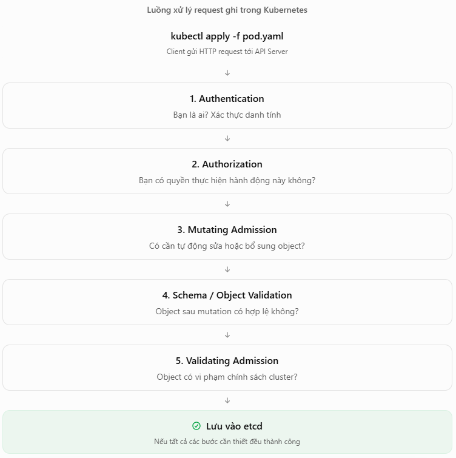
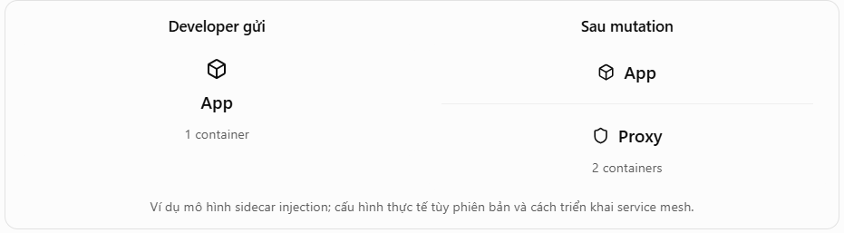

# Admission control dưới góc nhìn application developer

## Luồng xử lý của 1 Request

- Ban đầu bạn có 1 mainifest: `resources.yaml`
- Bạn chạy: `kubectl apply -f `



### 1. Authentication
Xác thực danh tính người gửi request
- Giả sử 1 cluster có 3 người: `alice`: developer, `bob`: DevOps, `admin`: quản trị viên.
- Khi bạn chạy lệnh: `kubectl get pods -n dev`
  - API Server phải xác định request này được gửi bởi ai.
  - Thông thường, kubectl sử dụng thông tin trong kubeconfig: `kubectl config view`
  - Kiểm tra certificate, token hoặc cơ chế xác thực đã cấu hình.
  - Xác định danh tính người gửi.
  - Chuyển danh tính đó cho bước Authorization.
  - **lưu ý**: Authentication không quyết định bạn được làm gì. Nó chỉ xác định bạn là ai.
```bash
root@bastion:~# kubectl config view
apiVersion: v1
clusters:
- cluster:
    certificate-authority-data: DATA+OMITTED
    server: https://192.168.70.124:6443
  name: my-first-cluster
contexts:
- context:
    cluster: my-first-cluster
    namespace: default
    user: admin@my-first-cluster
  name: admin@my-first-cluster
current-context: admin@my-first-cluster
kind: Config
users:
- name: admin@my-first-cluster
  user:
    client-certificate-data: DATA+OMITTED
    client-key-data: DATA+OMITTED
```
### 2. Authorization
Bạn có quyền làm việc đó không? Sau khi biết bạn là ai K8s phải xác thực quyền hạn của bạn

Một cơ chế rất phổ biến là **RBAC – Role-Based Access Control**.

Giả sử bạn tạo Role:
```yaml
apiVersion: rbac.authorization.k8s.io/v1
kind: Role
metadata:
  namespace: dev
  name: pod-developer
rules:
- apiGroups: [""]
  resources: ["pods"]
  verbs: ["get", "list", "create"]
```
Sau đó gán Role này cho 1 user nào đó bằng RoleBinding.
- Người đó sẽ chỉ có quyền get list create pod chứ không có quyền delete hay update pods

### 3. Admission
- Giả sử User được quyền tạo Pod nhưng:
```yaml
apiVersion: v1
kind: Pod
metadata:
  name: dangerous-pod
  namespace: dev
spec:
  containers:
  - name: nginx
    image: nginx:latest
    securityContext:
      privileged: true
```
Pod này yêu cầu container chạy ở chế độ privileged, có rủi ro bảo mật cao. RBAC thông thường không kiểm tra giá trị `privileged: true`. Đây là lý do Kubernetes cần Admission Control.

### 4. Mutating Admission
Tự động chỉnh sửa object trước khi nó được lưu.

Cluster có một Mutating Admission Webhook được quản trị viên cấu hình để thêm tài nguyên mặc định.

Developer không viết các trường này, nhưng object được API Server chấp nhận có thể chứa chúng.

Lưu ý rằng một số giá trị mặc định cũng được Kubernetes bổ sung bằng cơ chế defaulting thông thường, không nhất thiết do Mutating Admission Webhook thực hiện.

Ví dụ:
```yaml
apiVersion: v1
kind: Pod
metadata:
  name: nginx-demo
  labels:
    team: backend
spec:
  containers:
  - name: nginx
    image: nginx:1.27
    resources:
      requests:
        cpu: 100m
        memory: 128Mi
      limits:
        cpu: 500m
        memory: 512Mi
```
những trường như resources bạn không viết nhưng khi: `kubectl get pods -o yaml` thì nó hiện ra đó là mutating admission

Ví dụ 2: Sidecar Injection. Bạn chỉ định nghĩa một container:
```yaml
spec:
  containers:
  - name: app
    image: my-app:v1
```
Nhưng cluster có bật sidecar injection cho namespace phù hợp. Mutating webhook có thể bổ sung container proxy:
```yaml
spec:
  containers:
  - name: app
    image: my-app:v1

  - name: istio-proxy
    image: proxyv2:...
```


### 5. Validating Admission
Sau khi object được mutation và kiểm tra tính hợp lệ, Validating Admission sẽ đánh giá chính sách. Khác với Mutating, Validating Admission không được sửa object. Nó chỉ quyết định cho phép hoặc từ chối.

- Check bằng:
```bash
kubectl auth can-i create pods -n dev
```

### 6. Schema Validation
Manifest có đúng cấu trúc không?

### 7. Pod Security Admission
PSA là cơ chế admission tích hợp sẵn trong Kubernetes, dùng để áp dụng các tiêu chuẩn bảo mật cho Pod theo namespace.

PSA hỗ trợ ba mức chính sách:
- `privileged`: ít hạn chế nhất.
- `baseline`: chặn một số cấu hình đặc biệt nguy hiểm.
- `restricted`: hạn chế nghiêm ngặt hơn.

Và 3 chế độ thực thi:


- Ví dụ cấu hình PSA cho namespace:
```bash
kubectl label namespace dev \
  pod-security.kubernetes.io/enforce=restricted \
  pod-security.kubernetes.io/warn=restricted \
  pod-security.kubernetes.io/audit=restricted
```
Namespace `dev` được yêu cầu tuân thủ chính sách restricted trong cả ba chế độ.

### 8. Những thứ cần check

- Check quyền:
```bash
kubectl auth can-i create deployments -n dev
```
- Check chính sách Namespace
```bash
kubectl get ns dev --show-labels
```
- Check trước khi triển khai
```bash
kubectl apply -f app.yaml --dry-run=server -o yaml
```
- Xem object sau mutation
```bash
kubectl get pod my-pod -n dev -o yaml
```
- Check logs và events
```bash
kubectl describe pod my-pod -n dev
kubectl get events -n dev --sort-by=.lastTimestamp
```

## Lab: quan sát PSA từ chối Pod

Yêu cầu: Kubernetes có Pod Security Admission và quyền tạo namespace, Pod. Lab dùng namespace riêng để tránh đổi policy ứng dụng khác.

```bash
kubectl create namespace admission-lab
kubectl label namespace admission-lab pod-security.kubernetes.io/enforce=restricted
kubectl label namespace admission-lab pod-security.kubernetes.io/enforce-version=latest
kubectl -n admission-lab run bad --image=nginx:1.27 --restart=Never --dry-run=server -o yaml
```

Lệnh cuối dự kiến bị `Forbidden` với danh sách yêu cầu của restricted, chẳng hạn `allowPrivilegeEscalation=false`, drop `ALL` capabilities, `runAsNonRoot=true`, seccomp. Nếu cluster không bật PSA hoặc có policy khác, thông báo có thể khác. Tạo Pod đạt restricted theo cấu hình Linux:

```bash
kubectl -n admission-lab apply --dry-run=server -f - <<'EOF'
apiVersion: v1
kind: Pod
metadata:
  name: good
spec:
  securityContext:
    runAsNonRoot: true
    runAsUser: 101
    seccompProfile:
      type: RuntimeDefault
  containers:
  - name: web
    image: nginxinc/nginx-unprivileged:1.27
    securityContext:
      allowPrivilegeEscalation: false
      capabilities:
        drop: [ALL]
    ports:
    - containerPort: 8080
EOF
```

Nếu server dry-run thành công, chạy lại lệnh với `apply -f -` để tạo Pod. `nginx-unprivileged` dùng cổng 8080; image/tag cần có trên registry từ cluster lab. Admission chấp nhận object không đồng nghĩa image pull hoặc ứng dụng đã chạy tốt. Kiểm tra tiếp:

```bash
kubectl -n admission-lab get pod good
kubectl -n admission-lab describe pod good
kubectl -n admission-lab get pod good -o yaml
```

So YAML thực tế với manifest nhập vào để tìm trường được default/mutate. Nếu Pod bị từ chối, nó không tồn tại để `describe`; đọc lỗi trả về ngay từ `apply`. Nếu được tạo nhưng Pending/CrashLoopBackOff, chuyển sang debug scheduling/image/app.

## Tự kiểm tra

1. `warn` khác `enforce` thế nào?
2. Vì sao `--dry-run=client` không đủ để kiểm tra policy cluster?
3. Một Pod đã qua admission nhưng vẫn không Ready có thể do đâu?

## Dọn lab

```bash
kubectl delete namespace admission-lab
```

Nguồn: [Admission control](https://kubernetes.io/docs/reference/access-authn-authz/admission-controllers/), [Pod Security Admission](https://kubernetes.io/docs/concepts/security/pod-security-admission/).
