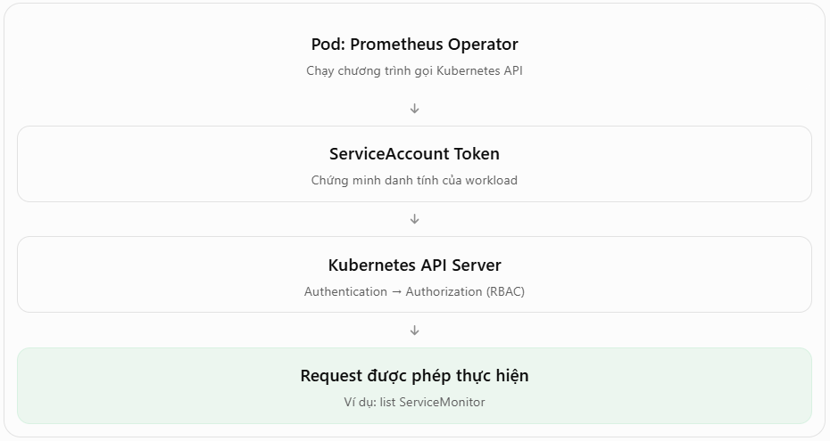
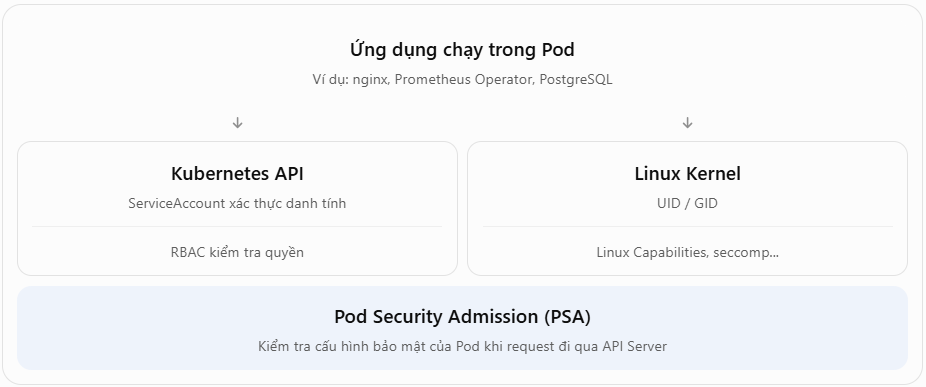

# ServiceAccount token, Linux capabilities và Pod Security Standards

## 1. Khái niệm

### 1.1 ServiceAccount (SA) 
Pod được phép làm gì với Kubernetes API?.
- Ví dụ bạn đang chạy Prometheus Operator: `prometheus-operator-7d8f9c...`
- Operator này cần theo dõi những tài nguyên như: `ServiceMonitor`, `Prometheus`, `PodMonitor`, `Secret`, `StatefulSet`
- Muốn làm được điều đó, chương trình Operator phải gửi request đến Kubernetes API Server.
- Nhưng API Server cần biết: Ai đang gửi request này? Và người đó có quyền thực hiện hành động không?



Khi bạn tạo:
```yaml
apiVersion: v1
kind: ServiceAccount
metadata:
  name: prometheus-reader
  namespace: monitoring
```
ServiceAccount này chỉ định nghĩa một danh tính. Danh tính khi được xác thực có dạng:
```yaml
system:serviceaccount:monitoring:prometheus-reader
```
Bạn muốn nó có quyền đọc ServiceMonitor thì cần cấp quyền bằng RBAC.
- Bước 1: Tạo Role
  - `apiGroups`: Nhóm API của ServiceMonitor.
  - `resources`: Loại tài nguyên được phép thao tác.
  - `verbs`: Các hành động được phép.
```yaml
apiVersion: rbac.authorization.k8s.io/v1
kind: Role
metadata:
  name: servicemonitor-reader
  namespace: monitoring
rules:
- apiGroups: ["monitoring.coreos.com"]
  resources: ["servicemonitors"]
  verbs: ["get", "list", "watch"]
```
- Bước 2: Gán role cho Service Account
```yaml
apiVersion: rbac.authorization.k8s.io/v1
kind: RoleBinding
metadata:
  name: servicemonitor-reader-binding
  namespace: monitoring
subjects:
- kind: ServiceAccount
  name: prometheus-reader
  namespace: monitoring
roleRef:
  kind: Role
  name: servicemonitor-reader
  apiGroup: rbac.authorization.k8s.io
```
- Bước 3: Gán Service Account cho Pod
```yaml
apiVersion: v1
kind: Pod
metadata:
  name: demo
  namespace: monitoring
spec:
  serviceAccountName: prometheus-reader
  containers:
  - name: demo
    image: nginx:1.27
```
Bây giờ Pod có danh tính `prometheus-reader`. Nếu chương trình trong Pod sử dụng token được mount để gọi API Server, nó sẽ được xác thực với danh tính đó.

Với RBAC ở trên, Pod được phép đọc ServiceMonitor trong namespace `monitoring`, nhưng không tự nhiên có quyền tạo hoặc xóa ServiceMonitor.

Nếu không khai báo ServiceAccount, Kubernetes sẽ mặc định sử dụng ServiceAccount tên default trong namespace của Pod. Mỗi namespace thông thường có ServiceAccount default riêng.
- Check bằng
```bash
kubectl get sa -A
```
- Check quyền:
```bash
kubectl auth can-i list pods \
  --as=system:serviceaccount:monitoring:prometheus-reader \
  -n monitoring
```
và
```bash
kubectl auth can-i list servicemonitors \
  --as=system:serviceaccount:monitoring:prometheus-reader \
  -n monitoring
```
Khi Pod dùng ServiceAccount và bật tự động mount token, Kubernetes có thể đưa token vào container thông qua một volume được kubelet quản lý.

Bên trong Container thường thấy:
```
/var/run/secrets/kubernetes.io/serviceaccount/
├── token
├── ca.crt
└── namespace
```
- `token`: Token để xác thực với Kubernetes API.
- `ca.crt`: CA certificate dùng để xác minh kết nối TLS tới API Server.
- `namespace`: Namespace của Pod.

Nên tắt token khi không cần
```yaml
apiVersion: v1
kind: Pod
metadata:
  name: nginx
spec:
  automountServiceAccountToken: false
  containers:
  - name: nginx
    image: nginx:1.27
```
- Nginx không cần gọi Kubernetes API. Nếu ứng dụng bị khai thác, kẻ tấn công có thể tìm cách sử dụng token đó để gọi API Server với quyền của ServiceAccount.

### 1.2 Linux capabilities 
Process bên trong container được phép làm gì với Linux kernel?

Nhưng container còn có thể thực hiện các thao tác ở cấp hệ điều hành, ví dụ:
- Mở socket mạng.
- Bind vào một cổng.
- Thay đổi một số cấu hình mạng.
- Gửi tín hiệu tới process.
- Thực hiện thao tác quản trị hệ thống.

Linux chia một phần quyền đặc biệt của root thành những capability riêng biệt.

**Ví dụ: NET_BIND_SERVICE**: Trong cấu hình Linux thông thường, bind vào cổng thấp hơn 1024 cần quyền phù hợp, chẳng hạn capability `CAP_NET_BIND_SERVICE`. Một số môi trường container có thể cấu hình ngưỡng cổng đặc quyền khác.

- bạn có thể cấu hình:
```yaml
apiVersion: v1
kind: Pod
metadata:
  name: web
spec:
  containers:
  - name: nginx
    image: nginx:1.27
    securityContext:
      runAsNonRoot: true
      runAsUser: 101
      allowPrivilegeEscalation: false
      capabilities:
        drop:
        - ALL
        add:
        - NET_BIND_SERVICE
```
Cấu hình này có nghĩa:
- `runAsNonRoot: true`: Yêu cầu container chạy non-root.
- `runAsUser: 101`: Chạy process với UID 101.
- `allowPrivilegeEscalation: false`: Ngăn process đạt thêm đặc quyền qua các cơ chế privilege escalation thông thường.
- `drop: [ALL]`: Bỏ tất cả Linux capabilities được cấp.
- `add: [NET_BIND_SERVICE]`: Chỉ thêm lại capability cần thiết để bind cổng đặc quyền.

| |RBAC |	Linux Capabilities|
|----|-------------|-------------|
| Bảo vệ |	Kubernetes API |	Linux kernel |
| Ví dụ |	Cho phép tạo Pod |	Cho phép bind cổng đặc quyền |
| Áp dụng cho |	User, Group, ServiceAccount |	Process/container Linux|
| Cấu hình |	Role, ClusterRole, Binding |	`securityContext.capabilities`|

### 1.3 Pod Security Standards (PSS)
Kubernetes có cho phép một Pod với cấu hình bảo mật như vậy được tạo hay không?

Nếu người dùng tạo 1 Pod yêu cầu chia sẻ PID namespace của host và chạy container ở chế độ privileged.

Kubernetes cần một cơ chế chính sách để kiểm soát những cấu hình như vậy. **Pod Security Standards (PSS) và Pod Security Admission (PSA)**.

**3 Mức bảo mật**
- **Privileged — Ít hạn chế nhất**: Cho phép các cấu hình đặc quyền cao. Thường cần cho một số thành phần hạ tầng như CNI hoặc storage plugin.
- **Baseline — Chặn các cấu hình nguy hiểm phổ biến**: Ví dụ hạn chế privileged containers, host namespaces và một số capability nguy hiểm.
- **Restricted — Chặt chẽ nhất**: Yêu cầu thêm nhiều cấu hình bảo mật như chạy non-root, không privilege escalation, seccomp phù hợp và drop ALL capabilities.


PSA hoạt động thông qua namespace labels:
- Chính sách Restricted:
```bash
kubectl label namespace secure-app \
  pod-security.kubernetes.io/enforce=restricted
```
PSA có 3 chế độ:

| Chế độ |	Hành vi|
|---------|-----------|
| enforce |	Từ chối Pod vi phạm|
| warn |	Cho phép nhưng trả warning|
| audit |	Cho phép nhưng ghi annotation vào audit event nếu có audit logging phù hợp| 

Ví dụ:
```bash
kubectl label namespace secure-app \
  pod-security.kubernetes.io/enforce=baseline \
  pod-security.kubernetes.io/warn=restricted \
  pod-security.kubernetes.io/audit=restricted
```

Nghĩa là:
- Vi phạm Baseline → bị từ chối.
- Đạt Baseline nhưng vi phạm Restricted → vẫn được tạo, nhưng có warning và có thể được ghi nhận qua audit.

Ba mức chính sách (privileged, baseline, restricted) và ba chế độ thực thi (enforce, warn, audit) là hai khái niệm khác nhau.

## Lab 1: SA và token

Yêu cầu: cluster lab và quyền tạo namespace, SA, Pod. Dùng Bash.

```bash
kubectl create namespace identity-lab
kubectl -n identity-lab create serviceaccount reader
kubectl -n identity-lab apply -f - <<'EOF'
apiVersion: v1
kind: Pod
metadata:
  name: token-on
spec:
  serviceAccountName: reader
  containers:
  - name: app
    image: busybox:1.36
    command: [sh, -c, 'ls /var/run/secrets/kubernetes.io/serviceaccount; sleep 3600']
EOF
kubectl -n identity-lab wait --for=condition=Ready pod/token-on --timeout=120s
kubectl -n identity-lab logs token-on
kubectl -n identity-lab auth can-i list pods --as=system:serviceaccount:identity-lab:reader
```

Kết quả: token/CA/namespace được mount, nhưng SA mới không mặc nhiên có quyền list Pod. Không in nội dung token ra terminal/log.

Tạo Pod không mount token:

```bash
kubectl -n identity-lab apply -f - <<'EOF'
apiVersion: v1
kind: Pod
metadata:
  name: token-off
spec:
  serviceAccountName: reader
  automountServiceAccountToken: false
  containers:
  - name: app
    image: busybox:1.36
    command: [sh, -c, 'ls /var/run/secrets/kubernetes.io/serviceaccount 2>&1 || true; sleep 3600']
EOF
kubectl -n identity-lab wait --for=condition=Ready pod/token-off --timeout=120s
kubectl -n identity-lab logs token-off
```

Kết quả: đường dẫn token không tồn tại. Chỉ cấp RBAC khi ứng dụng thật sự cần; kiểm tra quyền bằng `auth can-i` trước khi thêm Role/RoleBinding.

## Lab 2: capabilities và restricted

```bash
kubectl label namespace identity-lab pod-security.kubernetes.io/enforce=restricted
kubectl label namespace identity-lab pod-security.kubernetes.io/enforce-version=latest
kubectl -n identity-lab apply --dry-run=server -f - <<'EOF'
apiVersion: v1
kind: Pod
metadata:
  name: secure-web
spec:
  serviceAccountName: reader
  automountServiceAccountToken: false
  securityContext:
    runAsNonRoot: true
    runAsUser: 101
    seccompProfile:
      type: RuntimeDefault
  containers:
  - name: web
    image: nginxinc/nginx-unprivileged:1.27
    ports:
    - containerPort: 8080
    securityContext:
      allowPrivilegeEscalation: false
      capabilities:
        drop: [ALL]
EOF
```

Nếu được chấp nhận, chạy lại với `apply -f -` và xem `kubectl -n identity-lab describe pod secure-web`. Thử bỏ `drop: [ALL]` trong file thử để quan sát lỗi admission. Thử thêm `NET_ADMIN`: restricted sẽ từ chối; `NET_BIND_SERVICE` là capability duy nhất được thêm lại theo PSS restricted cho Linux. Pod cũ không bị xóa khi namespace vừa được gắn nhãn enforce; policy kiểm tra request tạo/cập nhật Pod tiếp theo.




## Dọn lab

```bash
kubectl delete namespace identity-lab
```

