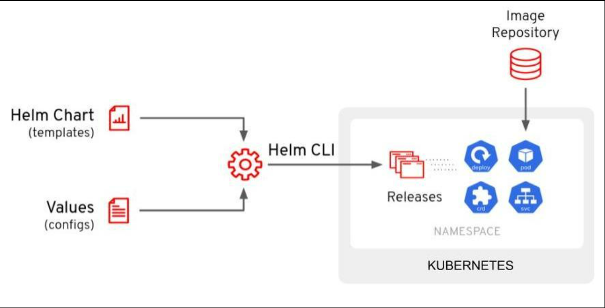
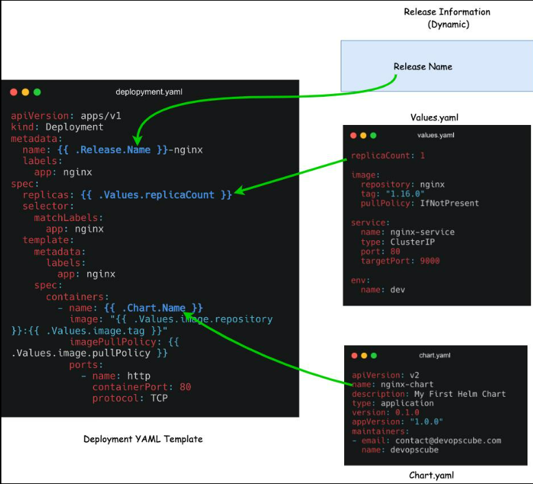
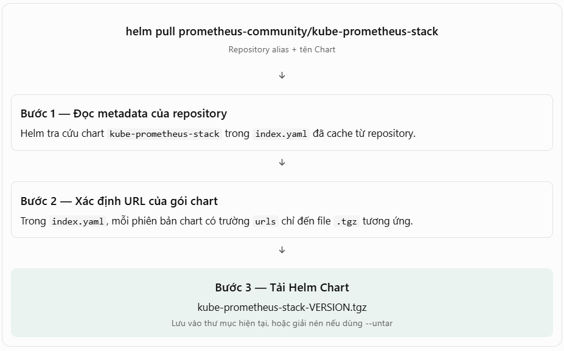

# Helm
## 1. Vấn đề
- Trong Kubernetes bình thường, nếu deploy thủ công, bạn phải viết:

```
deployment.yaml
service.yaml
configmap.yaml
```
- Vấn đề là bạn có nhiều môi trường:
```
DEV
replicas: 1
image: flasky:1.0

PROD
replicas: 5
image: flasky:2.0
```
- Bạn phải chia ra làm nhiều file YAML như:
```
dev-deployment.yaml
prod-deployment.yaml
```
## 2. Khái niệm Helm
Helm xuất hiện để giải quyết vấn đề trên



- User chỉ phải viết file YAML 1 lần, chỗ nào cần thay đổi thì biến nó thành variables.
- Lấy ví dụ 1 Deployment bình thường:
```yaml
apiVersion: apps/v1
kind: Deployment

spec:
  replicas: 3
```
Helm thay đổi:
```yaml
apiVersion: apps/v1
kind: Deployment

spec:
  replicas: {{ .Values.replicaCount }}
```
Trong Helm template có:
```yaml
# values.yaml

replicaCount: 3
```
Helm sẽ lấy: `{{ .Values.replicaCount }}` và thay bằng `3`
- Hay như file:
```yaml
deployment.yaml

replicas: {{ .Values.replicaCount }}
image: {{ .Values.image }}
```
- Đây là ý tưởng của Helm




## 2.1 Ý tưởng là
Helm là một package manager (trình quản lý gói) cho Kubernetes tương tự như `apt` chu Ubuntu hay `npm` cho Node.js

- Khi triển khai một ứng dụng lên Kubernetes theo cách thủ công, bạn thường phải viết rất nhiều file YAML: Deployment, Service, ConfigMap, Secret, Ingress, PVC... Nếu ứng dụng phức tạp (ví dụ WordPress cần thêm MySQL), số lượng file YAML tăng lên rất nhanh và khó quản lý.
  - Cần deploy cùng một ứng dụng ở nhiều môi trường (dev, staging, production) với cấu hình khác nhau.
  - Cần Update phiên bản ứng dụng
  - Cần rollback khi có lỗi
  - Cần chia sẻ ứng dụng cho người khác.

Helm giải quyết vấn đề bằng cách gói tất cả YAMl đó thành 1 template có thể tái sử dụng, tham số hóa được.


## 3. Chart
- Chart đơn giản là một folder chứa template + values + thông tin của application.
- Là một "gói" Helm — giống như một package. Một Chart chứa các file template YAML cộng với metadata mô tả cách deploy một ứng dụng (hoặc một nhóm ứng dụng liên quan). Cấu trúc cơ bản của 1 chart:
- Ví dụ như:
```bash
flasky/
├── Chart.yaml
├── values.yaml
└── templates/
      ├── deployment.yaml
      ├── service.yaml
      └── configmap.yaml
```


## 4. CLi
- Check Version
```bash
helm version
```
- Add the official nginx helm repository
```bash
helm repo add nginx-stable https://helm.nginx.com/stable
```
Helm sẽ truy cập trang nginx stable đó để biết repository đó chứa những chart nào.

Helm lưu tên repository và URL trong cấu hình trên máy đang chạy Helm CLI, không phải tự động lưu vào Kubernetes cluster.

nginx-stable là alias cho `https://helm.nginx.com/stable`

- Update the Repository:
```bash
helm repo update
```
Helm tải lại file từ các repository đã đăng ký và cập nhật cache trên máy. Nó không tự upgrade các ứng dụng đang chạy trên Kubernetes.

- Search for available nginx charts:
```bash
helm search repo nginx
```
tìm chart từ metadata đã cache.

- Get detailed information about the nginx-ingress chart:
```bash
helm show chart nginx-stable/nginx-ingress
```
- View the default values for this chart:
```bash
helm show values nginx-stable/nginx-ingress
```
- List the configured repositories:
```bash
helm repo list
```

- Install the nginx-ingress chart with specific configurations:


## 5. So sánh việc sử dụng và không sử dụng Helm

| Tiêu chí / Thao tác | Không dùng Helm | Dùng Helm |
| --- | --- | --- |
| **Quản lý cấu hình môi trường** | Copy-paste nhiều file YAML, sửa tay từng chỗ | 1 Chart + đổi `values.yaml` cho mỗi môi trường |
| **Cập nhật ứng dụng** | Update version = sửa YAML thủ công rồi `kubectl apply` | `helm upgrade` — có versioning, dễ rollback |
| **Theo dõi lịch sử (History)** | Không có lịch sử thay đổi rõ ràng | Helm lưu lịch sử các lần upgrade/rollback |
| **Chia sẻ & Phân phối** | Khó chia sẻ ứng dụng cho người khác | Đóng gói Chart, đẩy lên repo, người khác chỉ cần `helm install` |
| **Quản lý phụ thuộc (Dependencies)** | Không quản lý dependency giữa các service | Chart có thể khai báo dependency (VD: WordPress cần MySQL) |


## 6. Cli
- Create a namespace for the ingress controller:
```bash
kubectl create namespace nginx-ingress
```
- Install the nginx-ingress chart with specific configurations:
```bash
helm install my-nginx-ingress nginx-stable/nginx-ingress
  --namespace nginx-ingress \
  --set controller.replicaCount=2 \
  --set controller.service.type=NodePort \
  --set controller.service.httpPort.nodePort=30080 \
  --set controller.service.httpsPort.nodePort=30440
```
- Check the Helm release status:
```bash
helm status my-nginx-ingress -n nginx-ingress
```
- List all Helm releases:
```bash
helm list -A
```
- Verify the pods are running:
```bash
kubectl get pods -n nginx-ingress
```
- Check the service configuration:
```bash
kubectl get svc -n nginx-ingress
```
- Get the release history:
```bash
helm history my-nginx-ingress -n nginx-ingress
```
- View the generated Kubernetes manifests:
```bash
helm get manifest my-nginx-ingress -n nginx-ingress
```


## 7. Tự tạo 1 Helm Repository nội bộ

- Tạo thư mục:
```bash
mkdir -p ~/helm-repo
cd ~/helm-repo
```
- Đóng gói chart local 
```bash
helm package /path/to/mychart
```
- Tạo index file
```bash
helm repo index .
```
- Chạy http server bằng Docker:
```bash
docker run -d \
  --name helm-repo \
  -p 8080:80 \
  -v "$PWD":/usr/share/nginx/html:ro \
  nginx:stable
```
Từ máy khác trong mạng, bạn có thể thêm repository:
```bash
helm repo add internal \
  http://192.168.100.10:8080
```
rồi:
```bash
helm repo update
helm search repo internal
helm pull internal/mychart
```

### 7.1 Sự khác biệt giữa Git Server và Helm Repository

| Git Server (Gitea/GitLab) |	Helm Repository|
|---------------------------|-----------------|
| Lưu source Helm Chart |	Lưu chart đã đóng gói|
| Có commits, branches, history |	Có danh mục chart và versions|
| Dùng để sửa và phát triển chart |	Dùng để phân phối chart|
| `git clone`, `git push` |	`helm repo add`, `helm pull`|

Hãy hình dung:
- helm repo add: Đăng ký địa chỉ kho.
- helm repo update: Cập nhật danh sách sản phẩm trong kho.
- helm pull: Tải một sản phẩm về máy.
- helm install: Triển khai sản phẩm lên Kubernetes.
- helm create: Tạo bộ khung chart mới để tự phát triển.


Lệnh helm pull hay helm install lưu ý chánh nhầm lẫn:

Ví dụ:
```bash
helm repo add myrepo \
  https://prometheus-community.github.io/helm-charts

helm pull prometheus-community/kube-prometheus-stack
```



Nó không lấy theo kiểu `https://prometheus-community.github.io/helm-charts/kube-prometheus-stack` nó không hoạt động theo kiểu này mà nó sẽ vào helm chart này và tra cứu tên kube-prometheus-stack rồi lấy đường link trong file index.yaml của kube-prometheus-stack

### 7.2 Helm có thể cài trực tiếp

- Nếu bạn đi đường vòng khi bạn chạy lệnh này:
```bash
helm pull prometheus-community/kube-prometheus-stack
```
- Bạn sẽ chỉ nhận được 1 file `.tgz`. Bên trong file đó là:
```bash
kube-prometheus-stack/
├── Chart.yaml
├── values.yaml
├── templates/
│   ├── deployment.yaml
│   ├── service.yaml
│   └── ...
├── charts/
└── ...
```
- Bạn có thể giải nén:
```bash
helm pull prometheus-community/kube-prometheus-stack --untar
```
- Ngoài ra: Helm có khả năng đọc và xử lý Chart ngay bên trong file .tgz, không cần bạn tự giải nén trước.

```bash
helm install
```
Lệnh này thực hiện toàn bộ quy trình: lấy template của Chart, kết hợp với các giá trị cấu hình (values), dịch chúng thành các Kubernetes manifests (Deployment, Service, PVC...), rồi gọi Kubernetes API để tạo ra các đối tượng đó trên cluster.