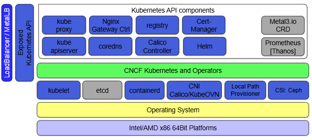

<!-- Standalone source reference copied 2026-10-08. Read docs/09-New-Cluster.md for fresh-cluster context; historical status is not a test result for your new cluster. -->

# Kiến trúc hạ tầng Kubernetes cho Genestack



The full scale Genestack infrastructure is bound to change over time, however, the idea is to keep things simple and transparent. The above graphic highlights how we deploy our environments and what the overall makeup of our platforms are expected to look like.

When you're building the cloud, many of the underlying infrastructure components have a deployment choice of `base` or `aio`.

- `base` creates a production-ready environment that ensures an HA system is deployed across the hardware available in your cloud.
- `aio` creates a minimal cloud environment which is suitable for test, which may have low resources.

Sơ đồ mô tả các lớp hạ tầng mà Genestack sử dụng: phần cứng, hệ điều hành, Kubernetes, controller/operator và các thành phần công bố API. Đây là kiến trúc tham chiếu; sự hiện diện của một thành phần trong sơ đồ không xác nhận nó đã được cài trong cụm thử nghiệm.

```text
┌─────────────────────────────────────┐
│ LoadBalancer / MetalLB              │
│ Exposed Kubernetes API              │
├─────────────────────────────────────┤
│ Kubernetes API components/add-ons   │
│ kube-proxy, CoreDNS, Helm, ...      │
├─────────────────────────────────────┤
│ CNCF Kubernetes and Operators       │
├─────────────────────────────────────┤
│ kubelet / etcd / containerd / CNI   │
│ Local Path / CSI Ceph               │
├─────────────────────────────────────┤
│ Operating System                    │
├─────────────────────────────────────┤
│ Intel/AMD x86_64 hardware           │
└─────────────────────────────────────┘
```

## 1. Lớp phần cứng và máy ảo

```text
Intel/AMD x86 64 Bit Platforms
```

Lớp phần cứng gồm máy chủ vật lý hoặc máy ảo chạy kiến trúc x86_64.

Ví dụ:

```text
Bare metal
hoặc
VM trên OpenStack / VMware
```

---

## 2. Hệ điều hành node

```text
Operating System
```

Đây là OS của node Kubernetes.

Nếu đi nhánh Kubespray:

```text
Ubuntu
↓
Kubespray
↓
Kubernetes
```

Nếu đi nhánh Talos:

```text
Talos Linux
↓
Kubernetes
```

Sơ đồ sử dụng tên tổng quát Operating System vì lớp Kubernetes có thể được triển khai trên các lựa chọn hệ điều hành khác nhau.

---

## 3. Thành phần nền tảng của Kubernetes
```text
kubelet
etcd
containerd
CNI Calico/KubeOVN
Local Path Provisioner
CSI: Ceph
```

Đây là các thành phần nền tảng để Kubernetes thực sự chạy.

### `kubelet`

Chạy trên từng node.

Nhiệm vụ:

```text
Kubernetes API
     ↓
kubelet
     ↓
container runtime
     ↓
Pod/container
```

kubelet nhận cấu hình pod được phân công cho node và phối hợp với container runtime để duy trì trạng thái container tương ứng.

---

### `etcd`

Database trạng thái của Kubernetes.

Nó lưu:

```text
Pods
Nodes
Secrets
ConfigMaps
Deployments
Services
...
```

### `containerd`

Container runtime.

```text
kubelet
   ↓
containerd
   ↓
container
```

containerd thực hiện tải image và quản lý vòng đời container theo yêu cầu của kubelet.

---

### `CNI Calico/KubeOVN`

CNI cung cấp kết nối mạng cho pod.

```text
Pod A
   ↓
CNI
   ↓
Pod B
```

Các chức năng của lớp CNI gồm:

```text
Pod IP
routing
overlay
network policy
```

Trong hình họ ghi:

```text
Calico / KubeOVN
```

nghĩa là có thể dùng một trong các CNI này.

Cụm Talos tham chiếu sử dụng Kube-OVN cho lớp mạng pod.

---

### `Local Path Provisioner`

Đây là storage provisioner đơn giản cho Kubernetes.

Khi PVC được tạo:

```text
PVC
 ↓
StorageClass
 ↓
Local Path Provisioner
 ↓
local disk trên node
```

Phù hợp cho:

```text
lab
dev
non-HA storage
```

Trong cụm tham chiếu, chức năng này được cung cấp bởi rancher/local-path-provisioner.

---

### `CSI: Ceph`

Ceph cung cấp storage phân tán; CSI kết nối các volume Ceph với workload Kubernetes.

```text
Pod
 ↓
PVC
 ↓
CSI
 ↓
Ceph
```

Nếu Local Path là:

```text
local disk
```

thì Ceph là:

```text
distributed storage cluster
```

Khả năng chịu lỗi phụ thuộc số node, số bản sao và các miền lỗi được cấu hình; mô hình một node không tự cung cấp HA.

---

## 4. Controller, Operator và các thành phần mở rộng

Thanh xanh:

```text
CNCF Kubernetes and Operators
```

Lớp này tập hợp các controller, Operator và addon phục vụ vận hành trên Kubernetes.

Tên lớp biểu thị một nhóm thành phần, không phải một dịch vụ riêng.

Các chức năng tiêu biểu:

```text
Kubernetes primitives
+
Operators
+
Controllers
+
CRDs
```

để quản lý các thành phần phức tạp.

---

## 5. API và dịch vụ hỗ trợ Kubernetes

Phần phía trên có:

```text
kube proxy
Nginx Gateway Ctrl
registry
Cert-Manager

kube apiserver
coredns
Calico Controller
Helm
```

Đây là các service/addon của Kubernetes cluster.

---

### `kube-apiserver`

kube-apiserver cung cấp giao diện API để các công cụ và controller truy cập trạng thái Kubernetes.

Ví dụ thao tác quản trị:

```bash
kubectl get pods
```

thì:

```text
kubectl
  ↓
kube-apiserver :6443
  ↓
Kubernetes
```

---

### `kube-proxy`

Thường xử lý Service networking.

Ví dụ:

```text
Service IP
   ↓
kube-proxy rules
   ↓
Pod
```

Tùy CNI/implementation, vai trò thực tế có thể thay đổi hoặc được thay thế.

---

### `CoreDNS`

DNS nội bộ Kubernetes.

Ví dụ Pod truy cập:

```text
keystone-api.openstack.svc.cluster.local
```

CoreDNS resolve tên đó ra Service IP.

---

### `Nginx Gateway Ctrl`

Gateway/Ingress controller.

Controller điều phối đường truy cập từ ngoài đến dịch vụ trong cụm:

```text
User
 ↓
Gateway/Ingress
 ↓
Service
 ↓
Pod
```

---

### `registry`

Container image registry.

Dùng để lưu:

```text
Docker/OCI images
```

Ví dụ:

```text
nova image
neutron image
keystone image
```

Các node tải image từ registry để tạo container.

---

### `Cert-Manager`

Tự động quản lý TLS certificate.

Ví dụ:

```text
skyline.example.com
keystone.example.com
```

Cert-manager có thể:

```text
request cert
renew cert
manage Secret
```

và kết hợp Let's Encrypt.

---

### `Calico Controller`

Nếu dùng Calico thì đây là controller quản lý networking/policy của Calico.

Kube-OVN sử dụng tập hợp controller riêng thay cho các thành phần Calico tương ứng.

Calico Controller trong sơ đồ thuộc một lựa chọn CNI của kiến trúc tham chiếu.

---

### `Helm`

Helm là package manager của Kubernetes.

Genestack dùng Helm để triển khai rất nhiều component.

Ví dụ:

```text
Helm chart
   ↓
Deployment
Service
ConfigMap
Secret
DaemonSet
...
```

---

## 6. Cấp phát địa chỉ Service LoadBalancer

Bên phải có:

```text
Metal3.io CRD
Prometheus [Thanos]
```

và bên trái:

```text
LoadBalancer / MetalLB
```

### MetalLB

Kubernetes trên bare metal hoặc private cloud cần một thành phần tích hợp để cấp phát địa chỉ cho Service type=LoadBalancer. Việc tạo Service không tự triển khai AWS ELB hoặc OpenStack Octavia nếu cụm chưa có cloud-controller hay bộ tích hợp tương ứng.

MetalLB làm:

```text
Service type LoadBalancer
        ↓
MetalLB
        ↓
IP từ pool
```

Ví dụ:

```text
192.168.100.50
```

được cấp làm VIP.

Cấu hình được mô tả trong ví dụ Genestack:

```text
VIP address internally ... within MetalLB
```

thì chính là phần này.

---

## 7. Công bố Kubernetes API

Thanh dọc bên trái:

```text
Exposed Kubernetes API
```

nghĩa là Kubernetes API được expose ra ngoài cluster để admin/tool truy cập.

Ví dụ:

```text
Laptop/Bastion
    ↓
https://controller:6443
    ↓
kube-apiserver
```

Đường truy cập này cho phép công cụ quản trị kết nối đến Kubernetes API từ ngoài cụm.

---

## 8. Công bố dịch vụ qua load balancer

Thanh ngoài cùng:

```text
LoadBalancer / MetalLB
```

nghĩa là các service cần public/internal VIP được expose qua LB.

Ví dụ:

```text
Keystone
Skyline
Glance
Nova API
```

có thể đi theo:

```text
Client
  ↓
VIP / LoadBalancer
  ↓
Gateway
  ↓
Kubernetes Service
  ↓
Pod
```

---

## 9. Quản lý vòng đời máy chủ bằng Metal3

`Metal3` thường dùng cho bare-metal lifecycle/provisioning.

Metal3 biểu diễn các đối tượng hạ tầng dưới dạng tài nguyên Kubernetes, ví dụ:

```text
BareMetalHost CRD
```

vào Kubernetes.

Ví dụ Kubernetes có thể quản lý:

```text
physical server provisioning
BMC/IPMI/Redfish
PXE provisioning
```

Metal3 chỉ cần thiết khi triển khai quy trình quản lý máy chủ bare metal tương ứng.

---

## 10. Giám sát bằng Prometheus và Thanos

Các thành phần này cung cấp giám sát và lưu trữ số liệu vận hành.

```text
Kubernetes/OpenStack components
        ↓
metrics
        ↓
Prometheus
        ↓
Thanos
```

Prometheus thu metrics.

Thanos thường bổ sung:

```text
long-term storage
HA
global query
multi-cluster
```

---

## 11. Mối quan hệ giữa hạ tầng Kubernetes và OpenStack

Genestack triển khai các dịch vụ trên Kubernetes. Các dịch vụ đó phụ thuộc vào container runtime, mạng pod, storage, DNS, chứng thư và đường truy cập API. Những thành phần giám sát và quản lý hạ tầng được bổ sung theo quy mô vận hành.

Có thể diễn giải thành:

```text
Hardware
   ↓
OS
   ↓
containerd + kubelet + etcd
   ↓
CNI + CSI
   ↓
Kubernetes
   ↓
DNS / Cert / Gateway / Helm / LB / Monitoring
   ↓
Genestack
   ↓
OpenStack
```

Các thành phần tương ứng trong cụm Talos tham chiếu:

```text
Talos
 ↓
Kubernetes
 ↓
Kube-OVN
 ↓
Local Path
 ↓
Helm
 ↓
OpenStack-Helm
```

Kiến trúc tham chiếu bao gồm thêm các lựa chọn như MetalLB, cert-manager, Prometheus và Ceph. Cấu hình thực tế của cụm được đối chiếu theo từng thành phần, không suy ra từ sơ đồ.
