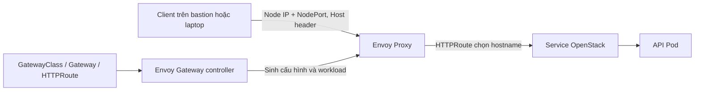

<!-- Standalone source reference copied 2026-10-08. Read docs/09-New-Cluster.md for fresh-cluster context; historical status is not a test result for your new cluster. -->

# Gateway API cho OpenStack trên Talos — theo mô hình Genestack

Tài liệu trình bày giai đoạn thiết lập Gateway và HTTPS cho Horizon. Image cùng chart Horizon sau khi tích hợp Octavia Dashboard được quản lý theo [chương 08](../docs/08-Octavia-Genestack.md); kết quả revision trong tài liệu này thuộc giai đoạn trước đó.

## 1. Thiết kế và phạm vi

Tiếp nối [05.Openstackhelm.md](05.Openstackhelm.md) và [06.OpenstackOperatorMigration.md](06.OpenstackOperatorMigration.md). Tài liệu này là quy trình chuẩn bị/triển khai mới, **CRD đã Established, controller đã deployed/rollout thành công; Gateway đã được tạo, proxy đã Ready và Gateway Programmed=True; năm route đã tạo; Keystone HTTP discovery qua NodePort đã đạt; Keystone HTTPS discovery đã đạt, chưa nghiệm thu các API còn lại/catalog**. Các bước chạy trong Bash trên bastion, từng khối theo thứ tự; dừng khi lỗi. Không chạy toàn bộ tài liệu một lần.

Genestack dùng Envoy Gateway controller, EnvoyProxy, GatewayClass, Gateway và HTTPRoute. Lab giữ cách quản lý đó nhưng triển khai một Gateway trước để hiểu và kiểm tra traffic. Gateway API là mô hình cấu hình; Envoy Gateway đọc cấu hình; Envoy Proxy thực sự nhận và chuyển request. MetalLB/F5 không phải điều kiện bắt buộc để tạo HTTPRoute.



| Phần | Genestack trong repo | Thiết kế lab hiện tại |
|---|---|---|
| Envoy chart | OCI docker.io/envoyproxy/gateway-helm, pin v1.7.0 | Pin v1.9.2 để có Kubernetes 1.36 trong ma trận tương thích |
| Controller | envoyproxy-gateway-system | Giữ namespace/release theo Genestack |
| Gateway/EnvoyProxy | envoy-gateway | Giữ namespace, tạo eg-lab/flex-gateway |
| Expose | Service LoadBalancer + pool MetalLB | NodePort, không tự chọn VIP chưa xác nhận |
| Proxy replicas | Baseline HPA 2–9, worker affinity | Một replica; không HPA vì chưa có Metrics API |
| TLS | ACME hoặc issuer nội bộ | HTTP trước; TLS tự ký lab ở mục 8 tùy chọn |
| Hostname | Domain thật của triển khai | keystone.lab.test, nova.lab.test… |
| Routes | Mẫu theo từng OpenStack API | Các API đang có; route cùng namespace với backend |

Theo [ma trận Envoy Gateway](https://gateway.envoyproxy.io/news/releases/matrix/), dòng 1.9 có Kubernetes 1.36 trong phạm vi hỗ trợ, còn 1.7 không có. Đây là điều chỉnh phiên bản cho lab, không thay ý tưởng triển khai Genestack. CRD và controller phải cùng pin v1.9.2.

Gateway API đưa các API OpenStack ra ngoài Kubernetes; Octavia cung cấp load balancer cho tenant/VM, là dịch vụ khác. Cài Envoy không đồng nghĩa đã cài Octavia.

## 2. Kiểm tra điều kiện triển khai

**Mục đích:** phát hiện Gateway/Ingress/controller đã có, xác nhận node và Service backend. Không cài thêm khi chưa biết một controller/CRD cũ đang được quản lý thế nào.

```bash
kubectl config current-context
kubectl get nodes -o wide
helm list -A
kubectl get crd | grep -Ei 'gateway.networking.k8s.io|gateway.envoyproxy.io' || true
kubectl get deployments -A | grep -Ei 'envoy|gateway|metallb' || true
kubectl -n openstack get svc keystone-api nova-api neutron-server glance-api cinder-api
kubectl -n openstack get svc | grep placement
kubectl get svc -A --field-selector spec.type=NodePort
```

**Điều kiện đi tiếp:** node Ready, các API Service tồn tại; chưa có cài đặt Envoy/Gateway API cần bảo toàn. Nếu đã có CRDs hoặc controller, kiểm tra version/owner trước mục 3; không áp dụng đè CRD do một phần mềm khác quản lý. Kết quả RabbitMQ trước đó không thay thế kiểm tra này.

NodePort nhận traffic ở port do Kubernetes cấp, thường 30000–32767; bastion/laptop cần truy cập được IP node và port đó. Không thay firewall hay chọn port cố định khi chưa kiểm tra. HTTP trong giai đoạn đầu chỉ để kiểm tra routing lab, chưa dùng để gửi credentials qua mạng không tin cậy.

### 2.1. Kết quả kiểm tra đầu vào đã xác nhận

Context admin@my-first-cluster; controlplane-01/workerplane-01 Ready, Kubernetes v1.36.3, Talos v1.13.10. Không có output CRD gateway.networking.k8s.io/gateway.envoyproxy.io hoặc deployments Envoy/Gateway/MetalLB trong các truy vấn đã chạy. Năm Service keystone-api:5000, nova-api:8774, neutron-server:9696, glance-api:9292, cinder-api:8776 đều tồn tại, type ClusterIP. Kết quả đủ để bắt đầu cài CRD/controller theo mục 3–4; chưa chứng minh endpoints/API backend hoạt động.

Nova Helm revision 6 vẫn failed như đã ghi ở file 06. Không đổi Nova trong bước cài Gateway; chỉ đánh giá route Nova sau khi controller và Keystone route đạt. cert-manager đã deployed, không cài lại. Thiết kế bắt đầu bằng NodePort vì chưa thấy MetalLB trong kiểm kê. Chưa có kết quả tải chart, CRD apply hoặc controller rollout.

## 3. Lưu chart và cấu hình trên bastion

**Mục đích:** tải chart một lần, render/install cùng bản local; không phụ thuộc tarballs.opendev.org. Cần DNS/network tới Docker Hub và node phải pull được image.

**Đường dẫn:** charts và manifests ở ~/osh-lab/gateway-api. Thư mục này độc lập với chart OpenStack đã sửa.

```bash
(
set -eu
umask 077
mkdir -p ~/osh-lab/gateway-api/{charts,manifests,rendered,tls}
for chart in gateway-helm gateway-crds-helm; do
  if [ ! -d "$HOME/osh-lab/gateway-api/charts/$chart" ]; then
    helm pull "oci://docker.io/envoyproxy/$chart" --version v1.9.2 \
      --untar --untardir ~/osh-lab/gateway-api/charts
  fi
done
python3 - <<'PY'
from pathlib import Path
import yaml
root = Path.home() / 'osh-lab/gateway-api/charts'
for name in ['gateway-helm', 'gateway-crds-helm']:
    meta = yaml.safe_load((root / name / 'Chart.yaml').read_text())
    assert meta['name'] == name and str(meta['version']).lstrip('v') == '1.9.2', 'Sai chart/version: ' + name
    print('PASS chart: ' + name + ' ' + str(meta['version']))
PY
cat > ~/osh-lab/gateway-api/controller-values.yaml <<'EOF'
crds:
  enabled: false
EOF
)
```

**Kết quả:** hai chart PASS. controller-values.yaml tắt việc chart controller cài CRD lần nữa vì CRD được quản lý riêng ở mục 4. Không tải đè chart local đã có khác version; script sẽ dừng để đối chiếu.

### 3.1. Kết quả tải chart đã xác nhận

Hai chart gateway-helm và gateway-crds-helm đã pull thành công, Chart.yaml version/appVersion v1.9.2. Digest lần tải: controller sha256:be034275b55deeddd6b7bc1f4da6eeb02b8efc418a4a29e2b1977851b24b1e63; CRD sha256:940b88fe361cb22fb651e3075f649e9be885f35b1c8a990658c1a2acc2d2a678. Trước đó DNS bastion trả lỗi lookup registry-1.docker.io qua 127.0.0.53; lần retry đã thành công. Chưa xác định nguyên nhân DNS, không coi reboot là biện pháp sửa dứt điểm. Chart đã lưu local nên các lệnh render/install tiếp theo không cần tải chart lại; node vẫn cần mạng để pull container images.

Controller dùng crds.enabled=false vì CRDs được quản lý riêng ở mục 4.1. Kết quả xác nhận: CRD server-side apply thành công, bốn CRD chính Established; controller revision 1 deployed và rollout thành công.

## 4. Cài CRD và Envoy Gateway controller

### 4.1. CRD: định nghĩa loại tài nguyên

**Mục đích:** Kubernetes biết GatewayClass/Gateway/HTTPRoute/EnvoyProxy là gì. Chọn standard channel vì luồng này dùng HTTP/HTTPS, không cần TCPRoute experimental. Theo hướng dẫn upstream, render CRD rồi apply server-side để tránh hạn chế kích thước khi lưu CRD bằng Helm. CRD không nằm trong release controller và không tự mất khi uninstall controller.

```bash
(
set -eu
helm template envoy-gateway-crds ~/osh-lab/gateway-api/charts/gateway-crds-helm \
  --set crds.gatewayAPI.enabled=true \
  --set crds.gatewayAPI.channel=standard \
  --set crds.envoyGateway.enabled=true \
  > ~/osh-lab/gateway-api/rendered/crds.yaml
kubectl apply --server-side -f ~/osh-lab/gateway-api/rendered/crds.yaml
kubectl wait --for=condition=Established --timeout=120s \
  crd/gatewayclasses.gateway.networking.k8s.io \
  crd/gateways.gateway.networking.k8s.io \
  crd/httproutes.gateway.networking.k8s.io \
  crd/envoyproxies.gateway.envoyproxy.io
)
```

### 4.2. Controller: đọc cấu hình và tạo proxy

**Mục đích:** cài phần điều khiển, chưa phải HTTP proxy cho OpenStack. Namespace dùng theo Genestack. Không cần sửa Talos hostPath, cài lại CNI, database hay cert-manager cho bước HTTP này.

```bash
(
set -eu
cat > ~/osh-lab/gateway-api/controller-values.yaml <<'EOF'
crds:
  enabled: false
EOF
helm template envoyproxy-gateway ~/osh-lab/gateway-api/charts/gateway-helm \
  -n envoyproxy-gateway-system -f ~/osh-lab/gateway-api/controller-values.yaml \
  > ~/osh-lab/gateway-api/rendered/controller.yaml
helm upgrade --install envoyproxy-gateway ~/osh-lab/gateway-api/charts/gateway-helm \
  -n envoyproxy-gateway-system --create-namespace \
  -f ~/osh-lab/gateway-api/controller-values.yaml --wait --timeout 10m
kubectl -n envoyproxy-gateway-system rollout status deployment/envoy-gateway --timeout=300s
kubectl -n envoyproxy-gateway-system get pods -o wide
)
```

**Đạt:** release deployed, controller Ready. Chưa có data-plane proxy trước khi tạo Gateway là bình thường.

### 4.3. Kết quả đã xác nhận

GatewayClass/Gateway/HTTPRoute/EnvoyProxy CRD đều Established; manifest CRD còn tạo các extension CRD và safe-upgrades admission policy/binding. Output cũng có TCPRoute/TLSRoute/UDPRoute dù truyền channel=standard; ghi nhận theo manifest thực tế, không coi tên tham số là bằng chứng chỉ có CRD standard. Không xóa CRD để thu hẹp channel trong lần triển khai này.

Release envoyproxy-gateway revision 1 deployed; deployment envoy-gateway successfully rolled out. Output get pods bị cắt, chưa ghi nhận đầy đủ pod/node/restarts. Chưa tạo Gateway trong kết quả đã nhận, nên chưa xác nhận proxy NodePort/routing.

## 5. EnvoyProxy, GatewayClass và Gateway HTTP

**Mục đích:** một entry point cho các API. EnvoyProxy quy định Service NodePort/một replica; GatewayClass nối nó với controller; Gateway mở listener HTTP 80 cho *.lab.test. Controller ánh xạ port listener xuống port container không đặc quyền.

Routes chỉ được attach từ namespace có nhãn gateway-access=openstack. OpenStack route và backend đều ở openstack, nên không cần ReferenceGrant. Nếu sau này backend khác namespace mới cần ReferenceGrant; allowedRoutes và ReferenceGrant giải quyết hai quyền khác nhau.

```bash
kubectl create namespace envoy-gateway --dry-run=client -o yaml | kubectl apply -f -
kubectl label namespace openstack gateway-access=openstack --overwrite
cat > ~/osh-lab/gateway-api/manifests/gateway-http.yaml <<'EOF'
apiVersion: gateway.envoyproxy.io/v1alpha1
kind: EnvoyProxy
metadata:
  name: custom-proxy-config
  namespace: envoy-gateway
spec:
  provider:
    type: Kubernetes
    kubernetes:
      envoyService:
        name: openstack-gateway
        type: NodePort
        externalTrafficPolicy: Cluster
      envoyDeployment:
        replicas: 1
---
apiVersion: gateway.networking.k8s.io/v1
kind: GatewayClass
metadata:
  name: eg-lab
spec:
  controllerName: gateway.envoyproxy.io/gatewayclass-controller
  parametersRef:
    group: gateway.envoyproxy.io
    kind: EnvoyProxy
    name: custom-proxy-config
    namespace: envoy-gateway
---
apiVersion: gateway.networking.k8s.io/v1
kind: Gateway
metadata:
  name: flex-gateway
  namespace: envoy-gateway
spec:
  gatewayClassName: eg-lab
  listeners:
    - name: openstack-http
      hostname: '*.lab.test'
      port: 80
      protocol: HTTP
      allowedRoutes:
        namespaces:
          from: Selector
          selector:
            matchLabels:
              gateway-access: openstack
EOF
kubectl apply --dry-run=server -f ~/osh-lab/gateway-api/manifests/gateway-http.yaml
kubectl apply -f ~/osh-lab/gateway-api/manifests/gateway-http.yaml
kubectl wait gatewayclass/eg-lab --for=condition=Accepted --timeout=120s
kubectl -n envoy-gateway get gateway flex-gateway -o yaml
kubectl get deployment,svc,pods -A | grep -E 'openstack-gateway|envoy'
```

**Đạt:** GatewayClass Accepted=True, Gateway/listener Accepted, controller tạo proxy và Service NodePort. Đánh giá thêm Programmed/status sau khi proxy Ready; không lấy việc thiếu external LoadBalancer IP làm lỗi ở thiết kế NodePort. Proxy có thể nằm trong namespace controller theo deployment mode mặc định, không suy ra nó nằm cùng namespace Gateway.

### 5.1. Kết quả tạo Gateway và chờ data plane

Đã xác nhận EnvoyProxy custom-proxy-config, GatewayClass eg-lab và Gateway flex-gateway được tạo; GatewayClass Accepted=True. Gateway generation 1 Accepted=True; listener Accepted/ResolvedRefs/Programmed=True, attachedRoutes=0. Controller đã tạo Service openstack-gateway trong namespace envoyproxy-gateway-system: NodePort 80:31429, ClusterIP 10.108.157.98. Gateway addresses là hai node IP 192.168.207.137/.139, không phải VIP MetalLB.

Deployment proxy envoy-envoy-gateway-flex-gateway-e868ef77 lúc snapshot 0/1, pod 0/2 ContainerCreating, tuổi 4–5 giây. Gateway toàn cục Programmed=False, reason NoResources, message Envoy replicas unavailable. Listener Programmed=True không thay thế proxy readiness. Chưa có bằng chứng lỗi; cần đợi rollout trước HTTPRoute/test traffic.

```bash
kubectl -n envoyproxy-gateway-system rollout status \
  deployment/envoy-envoy-gateway-flex-gateway-e868ef77 --timeout=300s
kubectl -n envoy-gateway wait gateway/flex-gateway \
  --for=condition=Programmed --timeout=120s
kubectl -n envoyproxy-gateway-system get pods -o wide
```

Các tên deployment/pod trên là bằng chứng của lần triển khai này, không hardcode vào script dựng mới. Nếu rollout timeout, lấy pod theo nhãn gateway thay vì chọn pod controller:

```bash
kubectl -n envoyproxy-gateway-system describe pod \
  -l gateway.envoyproxy.io/owning-gateway-name=flex-gateway,gateway.envoyproxy.io/owning-gateway-namespace=envoy-gateway
kubectl -n envoyproxy-gateway-system get events --sort-by=.metadata.creationTimestamp | tail -30
```

Khi dựng lại, tra deployment mới bằng kubectl get deployment trong namespace controller; controller có thể sinh tên hash khác. Chỉ sang mục 6 khi proxy Ready và Gateway Programmed=True. Nếu ImagePullBackOff/ErrImagePull, kiểm tra image/registry kết nối trên node; DNS bastion tải Helm được không chứng minh node pull image được.

Kết quả chờ sau đó đã xác nhận: proxy rollout thành công, Gateway Programmed condition met, proxy 2/2 Running/restart 0, controller 1/1 Running/restart 0. Cả hai trên controlplane-01; proxy IP 10.16.0.39. Hai container proxy là envoy và shutdown-manager. Events bình thường; image Envoy distroless-v1.39.1 đã pull thành công. Trạng thái ContainerCreating trước đó là khởi tạo ban đầu, không cần xử lý lỗi hoặc restart. Đủ điều kiện sang mục 6; chưa có HTTPRoute hoặc kết quả curl trong output này.

## 6. HTTPRoute cho các API đang có

**Mục đích:** map từng hostname vào Service/port, giữ nguyên path như /v3 hoặc /v2.1. Script kiểm tra Service và port trước khi ghi routes, không hardcode IP pod. Một Service đã tồn tại chưa đảm bảo endpoint Ready, bước curl vẫn cần.

```bash
python3 - <<'PY'
import json
from pathlib import Path
import subprocess
import yaml
entries = [
    ('keystone', 'keystone-api', 5000),
    ('nova', 'nova-api', 8774),
    ('neutron', 'neutron-server', 9696),
    ('glance', 'glance-api', 9292),
    ('cinder', 'cinder-api', 8776)]
result = subprocess.run(['kubectl', '-n', 'openstack', 'get', 'svc', '-o', 'json'],
                        check=True, capture_output=True, text=True)
services = {x['metadata']['name']: x for x in json.loads(result.stdout)['items']}
objects = []
for name, backend, port in entries:
    assert backend in services, 'Thieu Service: ' + backend
    assert port in [p['port'] for p in services[backend]['spec']['ports']], 'Sai Service port: ' + backend
    objects.append({'apiVersion': 'gateway.networking.k8s.io/v1', 'kind': 'HTTPRoute',
                    'metadata': {'name': name + '-gateway-route', 'namespace': 'openstack',
                                 'labels': {'lab-component': 'openstack-gateway'}},
                    'spec': {'parentRefs': [{'name': 'flex-gateway', 'namespace': 'envoy-gateway',
                                            'sectionName': 'openstack-http'}],
                             'hostnames': [name + '.lab.test'],
                             'rules': [{'matches': [{'path': {'type': 'PathPrefix', 'value': '/'}}],
                                        'backendRefs': [{'name': backend, 'port': port}]}]}})
p = Path.home() / 'osh-lab/gateway-api/manifests/openstack-routes.yaml'
p.write_text(yaml.safe_dump_all(objects, sort_keys=False))
print('PASS: da ghi 5 routes vao ' + str(p) + '; chua apply')
PY
```

Chỉ sau PASS mới apply:

```bash
kubectl apply --dry-run=server -f ~/osh-lab/gateway-api/manifests/openstack-routes.yaml
kubectl apply -f ~/osh-lab/gateway-api/manifests/openstack-routes.yaml
kubectl -n openstack get httproute -l lab-component=openstack-gateway
kubectl -n openstack get httproute keystone-gateway-route -o yaml
```

**Đạt:** từng route có parent đúng flex-gateway và conditions Accepted=True, ResolvedRefs=True với observedGeneration hiện tại. Không chỉ nhìn HTTPRoute tồn tại. Placement/Horizon/noVNC/Octavia/Barbican thêm sau khi xác nhận Service và cấu hình hostname tương ứng; không tạo route trỏ service chưa cài.

## 7. Kiểm tra Keystone qua Gateway NodePort

**Mục đích:** kiểm tra đường truyền từ ngoài cụm qua Envoy đến Keystone. Lấy namespace/NodePort bằng Service đã đặt tên, không đoán port.

```bash
python3 - <<'PY'
import json
from pathlib import Path
import subprocess
result = subprocess.run(['kubectl', 'get', 'svc', '-A', '-o', 'json'],
                        check=True, capture_output=True, text=True)
items = [x for x in json.loads(result.stdout)['items'] if x['metadata']['name'] == 'openstack-gateway']
assert len(items) == 1, 'Service proxy chua co/khong duy nhat; xem controller va Gateway status'
svc = items[0]
port = next(p['nodePort'] for p in svc['spec']['ports'] if p['port'] == 80)
text = 'GATEWAY_NAMESPACE=' + svc['metadata']['namespace'] + '\nHTTP_NODEPORT=' + str(port) + '\n'
p = Path.home() / 'osh-lab/gateway-api/access.env'
p.write_text(text)
print(text)
PY
source ~/osh-lab/gateway-api/access.env
curl --max-time 15 -i -H 'Host: keystone.lab.test' "http://192.168.207.139:${HTTP_NODEPORT}/v3"
```

**Đạt:** response discovery Keystone với thông tin version v3. Response 404 của Envoy có thể do Host/route chưa attach; 503 có thể backend không có endpoints hoặc không truy cập được. HTTP 200 ở /v3 chứng minh route discovery, chưa chứng minh token/compute/volume.

Trên Windows dùng curl.exe để tránh alias PowerShell; thay NodePort bằng giá trị vừa in hoặc mở SSH tunnel từ Windows tới NodePort trên worker. Khi có DNS/hosts cho *.lab.test, hostname vẫn cần đi kèm NodePort. Domain .test là tên lab; không dùng Let's Encrypt cho tên này.

### 7.1. Kết quả HTTP đã xác nhận

Năm HTTPRoute Keystone/Nova/Neutron/Glance/Cinder đã tạo. Route Keystone generation 1 có Accepted=True và ResolvedRefs=True, parent envoy-gateway/flex-gateway listener openstack-http. Curl từ bastion tới worker 192.168.207.139:31429, Host keystone.lab.test, path /v3 trả HTTP 200 và version v3.14 stable. Proxy nằm trên controlplane-01; kết quả cũng xác nhận đường NodePort Cluster từ worker tới proxy hoạt động trong lần kiểm thử này.

Chưa kiểm tra status của bốn routes còn lại hoặc các thao tác authenticated API; không suy ra tất cả OpenStack API/VM/volume đã đạt. Discovery response có self link http://keystone.lab.test/v3/ không chứa NodePort; dùng URL NodePort tường minh trong giai đoạn lab, không lấy discovery link này làm bằng chứng DNS/catalog public đã hoàn chỉnh. Chưa đổi catalog và chưa test HTTPS. Bước tiếp theo là TLS lab ở mục 8.

## 8. Cấu hình TLS tại Gateway

**Mục đích:** HTTPS termination tại Envoy, backend API vẫn HTTP trong cluster. Dùng cert tự ký để thực hành, không thay cert-manager đang phục vụ RabbitMQ. Không coi certificate tự ký là chứng chỉ public được tin cậy.

```bash
(
set -eu
umask 077
if [ ! -f "$HOME/osh-lab/gateway-api/tls/tls.crt" ] || [ ! -f "$HOME/osh-lab/gateway-api/tls/tls.key" ]; then
  openssl req -x509 -newkey rsa:2048 -sha256 -nodes -days 30 \
    -keyout ~/osh-lab/gateway-api/tls/tls.key \
    -out ~/osh-lab/gateway-api/tls/tls.crt \
    -subj '/CN=*.lab.test' -addext 'subjectAltName=DNS:*.lab.test'
fi
kubectl -n envoy-gateway create secret tls wildcard-lab-tls \
  --cert="$HOME/osh-lab/gateway-api/tls/tls.crt" \
  --key="$HOME/osh-lab/gateway-api/tls/tls.key" --dry-run=client -o yaml | kubectl apply -f -
python3 - <<'PY'
from copy import deepcopy
from pathlib import Path
import yaml
root = Path.home() / 'osh-lab/gateway-api/manifests'
docs = list(yaml.safe_load_all((root / 'gateway-http.yaml').read_text()))
gw = next(d for d in docs if d['kind'] == 'Gateway')
listener = deepcopy(gw['spec']['listeners'][0])
listener.update({'name': 'openstack-https', 'port': 443, 'protocol': 'HTTPS',
                 'tls': {'mode': 'Terminate', 'certificateRefs': [{'kind': 'Secret', 'name': 'wildcard-lab-tls'}]}})
gw['spec']['listeners'].append(listener)
(root / 'gateway-https.yaml').write_text(yaml.safe_dump_all(docs, sort_keys=False))
routes = list(yaml.safe_load_all((root / 'openstack-routes.yaml').read_text()))
for route in routes:
    route['spec']['parentRefs'].append({'name': 'flex-gateway', 'namespace': 'envoy-gateway', 'sectionName': 'openstack-https'})
(root / 'openstack-routes-https.yaml').write_text(yaml.safe_dump_all(routes, sort_keys=False))
PY
kubectl apply -f ~/osh-lab/gateway-api/manifests/gateway-https.yaml
kubectl apply -f ~/osh-lab/gateway-api/manifests/openstack-routes-https.yaml
)
```

Kiểm tra listener HTTPS và lấy NodePort 443. Dùng --resolve để curl vừa kết nối Node IP vừa gửi đúng Host/SNI; --cacert tin certificate lab mà không tắt xác thực TLS:

```bash
source ~/osh-lab/gateway-api/access.env
kubectl -n envoy-gateway get gateway flex-gateway -o yaml
HTTPS_NODEPORT=$(kubectl -n "$GATEWAY_NAMESPACE" get svc openstack-gateway \
  -o jsonpath='{.spec.ports[?(@.port==443)].nodePort}')
test -n "$HTTPS_NODEPORT" && curl --max-time 15 -i \
  --cacert ~/osh-lab/gateway-api/tls/tls.crt \
  --resolve "keystone.lab.test:${HTTPS_NODEPORT}:192.168.207.139" \
  "https://keystone.lab.test:${HTTPS_NODEPORT}/v3"
``` TLS key chỉ giữ trên bastion/Secret, không đưa Git. Muốn chứng chỉ public cần domain thật, DNS/VIP và phương án ACME riêng.

### 8.1. Kết quả HTTPS đã xác nhận

Secret wildcard-lab-tls được tạo, Gateway thêm openstack-https, năm HTTPRoute cập nhật parentRefs HTTP/HTTPS. Gateway flex-gateway Programmed=True. Service openstack-gateway giữ ClusterIP 10.108.157.98, HTTP NodePort 31429 và HTTPS NodePort 31384. Curl từ bastion dùng --cacert và --resolve tới worker 192.168.207.139:31384 trả HTTP/2 200, Keystone v3.14 stable, self link https://keystone.lab.test:31384/v3/. Không dùng -k trong kết quả này, nên test đã kiểm tra certificate theo CA file và hostname.

Đã đạt cài controller/proxy, route Keystone HTTP và TLS termination HTTPS qua NodePort. Năm route có manifest nhưng mới có kết quả request Keystone; chưa nghiệm thu token, bốn API khác, Horizon/noVNC hoặc public catalog. Không ghi đây là triển khai VIP/MetalLB hoặc Octavia. Certificate lab có thời hạn 30 ngày từ lúc tạo; muốn renew phải tạo lại cert/key và cập nhật Secret, không chỉ apply lại file giữ certificate cũ.

### 8.2. Dùng hostname trên bastion thay cho --resolve

Đây là bước cấu hình client tùy chọn, không thay DNS của node/cluster và không đổi catalog. Các URL hiện tại cần port 31384. Khi dùng OpenStack CLI/trình duyệt, cần hostname resolve tới node reachable và client tin certificate. Không gửi credentials HTTP; dùng listener HTTPS.

Các hostname lab dự kiến:

| Hostname | URL client HTTPS | Backend |
|---|---|---|
| keystone.lab.test | https://keystone.lab.test:31384/v3 | keystone-api:5000 |
| nova.lab.test | https://nova.lab.test:31384/v2.1 | nova-api:8774 |
| neutron.lab.test | https://neutron.lab.test:31384 | neutron-server:9696 |
| glance.lab.test | https://glance.lab.test:31384 | glance-api:9292 |
| cinder.lab.test | https://cinder.lab.test:31384/v3 | cinder-api:8776 |

Các URL trên là thiết kế client, không phải bằng chứng tất cả API đã đạt. Port lấy từ Service thực tế; khi dựng lại không mặc định vẫn là 31384. Mapping hosts trên laptop phải được cấu hình ở laptop, không thừa hưởng /etc/hosts bastion. OpenStack CLI cần nạp credentials theo file 06 và OS_CACERT trỏ tới tls.crt, không chỉ activate virtualenv.

## 9. Vận hành, catalog và phát triển tiếp

| Muốn đổi | File cần sửa và cách áp dụng |
|---|---|
| Controller values | controller-values.yaml; render rồi helm upgrade bằng chart local mục 4.2 |
| Proxy replica/Service type | manifest EnvoyProxy trong gateway-http.yaml hoặc gateway-https.yaml đang sử dụng; kubectl apply |
| Listener/TLS | Gateway manifest đang sử dụng; kubectl apply |
| Hostname/backend route | openstack-routes.yaml hoặc openstack-routes-https.yaml đang sử dụng; kubectl apply |
| Đổi version Envoy | Kiểm tra tương thích CRD/controller/proxy, snapshot trước và theo quy trình upgrade upstream |

Sau bật TLS, dùng cặp files https làm cấu hình chính; apply lại files http sẽ bỏ listener/parent HTTPS. Không patch trực tiếp Service proxy vì controller có thể ghi đè; đổi EnvoyProxy.

Gateway route không tự sửa OpenStack catalog. Chưa thay public/internal endpoints Helm hoặc OS_AUTH_URL trong quy trình này. Sau khi hostname/port/TLS ổn định, mới thiết kế public endpoint overrides và đồng bộ catalog bằng chart từng dịch vụ; giữ internal endpoints để pod tiếp tục gọi nhau. Trên bastion, DNS/hosts phải resolve được các hostname trước khi CLI dùng endpoint Gateway.

Horizon cần kiểm tra allowed hosts/CSRF; noVNC cần public base URL và WebSocket; không chỉ thêm HTTPRoute rồi coi giao diện đã xong. Octavia/Barbican có thể thêm HTTPRoute sau khi services hoạt động, không phải điều kiện để dựng Gateway này.

Nâng từ NodePort lên mô hình Genestack có VIP: xác nhận MetalLB và một dải IP chưa sử dụng trên mạng node → đổi EnvoyProxy Service sang LoadBalancer và gắn pool → kiểm tra VIP reachable → DNS → TLS/domain thật → public catalog. Chưa xác nhận pool/IP nên tài liệu không tự dùng một địa chỉ bất kỳ. F5 nếu có nằm ngoài cluster, không cài F5 vào Kubernetes bằng Gateway API.

## 10. Chẩn đoán khi lỗi và bằng chứng bàn giao

Chỉ chạy khi bước không đạt:

```bash
kubectl -n envoyproxy-gateway-system logs deployment/envoy-gateway --tail=100
kubectl -n envoy-gateway describe gateway flex-gateway
kubectl -n openstack describe httproute keystone-gateway-route
kubectl -n openstack get endpointslices -l kubernetes.io/service-name=keystone-api
kubectl get pods -A | grep envoy
kubectl get events -A --sort-by=.metadata.creationTimestamp | tail -40
```

Ghi kết quả thực tế: version chart/CRD, controller Ready, Gateway/route conditions, namespace và NodePort proxy, HTTP/HTTPS response. Không đánh dấu cài thành công chỉ vì file YAML đã được tạo. Lưu manifest/values/charts và access.env; không lưu token/password trong báo cáo.

## 11. Nguồn đối chiếu

- [Genestack installer](genestack/bin/install-envoy-gateway.sh), [setup](genestack/bin/setup-envoy-gateway.sh), [version pin](genestack/helm-chart-versions.yaml).
- [Genestack Gateway base](genestack/base-kustomize/envoyproxy-gateway/base/envoy-gateway.yaml), [EnvoyProxy](genestack/base-kustomize/envoyproxy-gateway/base/envoy-custom-proxy-config.yaml), [route Keystone](genestack/etc/gateway-api/routes/custom-keystone-gateway-route.yaml).
- [Genestack single/multi Gateway](genestack/docs/infrastructure-envoy-gateway-multi-gateway.md).
- [Envoy Helm installation](https://gateway.envoyproxy.io/docs/install/install-helm/), [compatibility matrix](https://gateway.envoyproxy.io/news/releases/matrix/), [Envoy extension API](https://gateway.envoyproxy.io/docs/api/extension_types/).

## 12. Horizon qua HTTPS — giao diện sử dụng OpenStack

Năm HTTPRoute API đã tạo không bao gồm Horizon; mới Keystone được test discovery. Đích của phần này là https://horizon.lab.test:31384, người dùng đăng nhập và thao tác bằng giao diện. Horizon revision 2 đã deployed; trang đăng nhập qua HTTPS đã trả HTTP 200. Chưa nghiệm thu đăng nhập và thao tác trên dashboard. Horizon server gọi các API nội bộ; trình duyệt chủ yếu gọi Horizon. Không cần chuyển tất cả catalog public sang Gateway trước khi dùng dashboard. noVNC console là bước riêng vì browser cần truy cập public console URL/WebSocket.

### 12.1. Chuẩn bị chart Horizon và chụp cấu hình

Chạy trên bastion. Giữ chart version 2026.1.31+0ee5adeff. Tải từ cache trước (tránh DNS OpenDev), nếu không có thì helm pull. Không tải đè thư mục chart đã tồn tại. Giữ effective values để không đổi database/cache/Keystone của lab.

```bash
(
set -eu
umask 077
mkdir -p ~/osh-lab/charts ~/osh-lab/gateway-api/horizon
if [ ! -d ~/osh-lab/charts/horizon ]; then
  if [ -f ~/.cache/helm/repository/horizon-2026.1.31+0ee5adeff.tgz ]; then
    tar -xzf ~/.cache/helm/repository/horizon-2026.1.31+0ee5adeff.tgz -C ~/osh-lab/charts
  else
    helm pull openstack-helm/horizon --version '2026.1.31+0ee5adeff' --untar --untardir ~/osh-lab/charts
  fi
fi
python3 - <<'PY'
from pathlib import Path
import yaml
p = Path.home() / 'osh-lab/charts/horizon/Chart.yaml'
meta = yaml.safe_load(p.read_text())
assert meta['name'] == 'horizon' and str(meta['version']) == '2026.1.31+0ee5adeff', 'Sai chart Horizon'
print('PASS chart Horizon')
PY
kubectl -n openstack get svc horizon-int
helm -n openstack list --filter '^horizon$'
if [ ! -f ~/osh-lab/gateway-api/horizon/before.yaml ]; then
  helm get values horizon -n openstack --all -o yaml > ~/osh-lab/gateway-api/horizon/before.yaml
fi
)
```

Chỉ sang bước sau khi chart version đúng, Service horizon-int có port 80 và release deployed. before.yaml có thể chứa credentials; không công bố nguyên bản. File này dùng cho lần cập nhật Horizon HTTPS này, không dùng làm baseline mọi lần sửa sau.

### 12.2. Tạo override và render trước upgrade

Mục đích các key: allowed_hosts cho phép hostname dashboard; csrf_trusted_origins tin origin HTTPS có NodePort; secure_proxy_ssl_header nhận X-Forwarded-Proto=https do Envoy gửi; secure cookies chỉ gửi qua HTTPS; endpoint_type=internalURL để server Horizon gọi Service nội bộ trong catalog. Không tắt CSRF hoặc SSL verification để bỏ lỗi.

```bash
python3 - <<'PY'
from pathlib import Path
import subprocess
import yaml
root = Path.home() / 'osh-lab/gateway-api/horizon'
values = yaml.safe_load((root / 'before.yaml').read_text())
config = values['conf']['horizon']['local_settings']['config']
required = ['allowed_hosts', 'csrf_trusted_origins', 'secure_proxy_ssl_header',
            'use_ssl', 'csrf_cookie_secure', 'session_cookie_secure', 'endpoint_type']
assert all(k in config for k in required), 'Chart config khac du kien; dung de doi chieu keys'
hosts = [h for h in (config['allowed_hosts'] or []) if h != '*']
if 'horizon.lab.test' not in hosts:
    hosts.append('horizon.lab.test')
import json
proxy_service = json.loads(subprocess.check_output(
    ['kubectl', '-n', 'envoyproxy-gateway-system', 'get', 'svc', 'openstack-gateway', '-o', 'json'], text=True))
https_port = next(p['nodePort'] for p in proxy_service['spec']['ports'] if p['port'] == 443)
trusted_origin = 'https://horizon.lab.test:' + str(https_port)
origins = list(config['csrf_trusted_origins'] or [])
if trusted_origin not in origins:
    origins.append(trusted_origin)
override = {'conf': {'horizon': {'local_settings': {'config': {
    'allowed_hosts': hosts, 'csrf_trusted_origins': origins,
    'secure_proxy_ssl_header': True, 'use_ssl': 'True',
    'csrf_cookie_secure': 'True', 'session_cookie_secure': 'True',
    'endpoint_type': 'internalURL'}}}}}
(root / 'https-values.yaml').write_text(yaml.safe_dump(override, sort_keys=False))
result = subprocess.run(['helm', 'template', 'horizon', str(Path.home() / 'osh-lab/charts/horizon'),
                         '-n', 'openstack', '--is-upgrade', '-f', str(root / 'before.yaml'),
                         '-f', str(root / 'https-values.yaml')], capture_output=True, text=True, timeout=120)
(root / 'render-error.txt').write_text(result.stderr)
assert result.returncode == 0, 'Render loi; xem render-error.txt tren bastion, khong gui raw credentials'
(root / 'rendered.yaml').write_text(result.stdout)
# local_settings có thể ở Secret base64, không tìm chuỗi trên YAML raw.
import base64
import re
settings = []
for obj in yaml.safe_load_all(result.stdout):
    if not isinstance(obj, dict) or obj.get('kind') not in ('Secret', 'ConfigMap'):
        continue
    for value in (obj.get('data') or {}).values():
        try:
            text = base64.b64decode(value, validate=True).decode() if obj['kind'] == 'Secret' else str(value)
        except (ValueError, UnicodeError):
            continue
        if 'ALLOWED_HOSTS' in text and 'CSRF_TRUSTED_ORIGINS' in text:
            settings.append(text)
    for text in (obj.get('stringData') or {}).values():
        if 'ALLOWED_HOSTS' in text and 'CSRF_TRUSTED_ORIGINS' in text:
            settings.append(text)
assert settings, 'Khong tim thay local_settings trong ConfigMap/Secret rendered'
checks = {
    'ALLOWED_HOSTS': 'horizon.lab.test',
    'CSRF_TRUSTED_ORIGINS': trusted_origin,
    'SECURE_PROXY_SSL_HEADER': 'HTTP_X_FORWARDED_PROTO',
    'CSRF_COOKIE_SECURE': 'True',
    'SESSION_COOKIE_SECURE': 'True',
    'OPENSTACK_ENDPOINT_TYPE': 'internalURL'}
assert any(all(any(re.match(r'^\s*' + key + r'\s*=', line) and expected in line
                  for line in text.splitlines()) for key, expected in checks.items())
           for text in settings), 'Cau hinh HTTPS render chua du; khong upgrade'
print('PASS: da render Horizon HTTPS, chua upgrade')
PY
```

Kết quả đã xác nhận: chart local đúng version, Service horizon-int:80 tồn tại; kiểm tra cấu hình HTTPS trong Secret rendered đã PASS. Horizon đã upgrade lên revision 2 deployed. Cần giải mã Secret để kiểm tra local_settings vì nội dung được lưu dạng base64.

### 12.3. Upgrade Horizon và tạo route HTTPS

Chỉ chạy sau render PASS. Dùng đúng chart local và before + https-values để giữ cấu hình đang có. Sau bật secure cookies, port-forward HTTP cũ không còn là đường đăng nhập chính; dùng HTTPS Gateway.

```bash
(
set -eu
helm upgrade horizon ~/osh-lab/charts/horizon -n openstack \
  -f ~/osh-lab/gateway-api/horizon/before.yaml \
  -f ~/osh-lab/gateway-api/horizon/https-values.yaml \
  --wait --wait-for-jobs --timeout 15m
kubectl -n openstack get pods -l application=horizon -o wide
cat > ~/osh-lab/gateway-api/manifests/horizon-route.yaml <<'EOF'
apiVersion: gateway.networking.k8s.io/v1
kind: HTTPRoute
metadata:
  name: horizon-gateway-route
  namespace: openstack
  labels:
    lab-component: openstack-gateway
spec:
  parentRefs:
    - name: flex-gateway
      namespace: envoy-gateway
      sectionName: openstack-https
  hostnames:
    - horizon.lab.test
  rules:
    - matches:
        - path:
            type: PathPrefix
            value: /
      backendRefs:
        - name: horizon-int
          port: 80
EOF
kubectl apply --dry-run=server -f ~/osh-lab/gateway-api/manifests/horizon-route.yaml
kubectl apply -f ~/osh-lab/gateway-api/manifests/horizon-route.yaml
)
```

### 12.4. Kiểm tra truy cập bằng trình duyệt

**Mục đích:** kiểm tra request GET giống thao tác mở trang trên trình duyệt. Không dùng `curl -I` làm tiêu chí nghiệm thu Horizon: lần triển khai này HEAD trả 403 trong khi GET vào trang đăng nhập trả 200.

```bash
kubectl -n openstack get httproute horizon-gateway-route -o yaml
kubectl -n openstack get pods -l application=horizon -o wide
HTTPS_NODEPORT=$(kubectl -n envoyproxy-gateway-system get svc openstack-gateway -o jsonpath='{.spec.ports[?(@.port==443)].nodePort}')
: "${HTTPS_NODEPORT:?Gateway chua co HTTPS NodePort}"
for path in / /auth/login/; do
  curl --max-time 20 -sS -D - -o /dev/null \
    --cacert ~/osh-lab/gateway-api/tls/tls.crt \
    --resolve "horizon.lab.test:${HTTPS_NODEPORT}:192.168.207.139" \
    "https://horizon.lab.test:${HTTPS_NODEPORT}${path}"
done
```

**Kết quả đã xác nhận:** HTTPRoute Accepted=True/ResolvedRefs=True; pod Horizon 1/1 Running, restart 0; GET `/` trả 302 và GET `/auth/login/` trả 200. Redirect ở trang gốc là chuyển tới trang đăng nhập. Log Apache ghi nhận HEAD 403 và GET 302/200; chưa xác định cơ chế từ chối HEAD, nhưng không cần thay cấu hình để mở trang bằng GET.

Trên máy Windows dùng trình duyệt:

1. Mở `C:\Windows\System32\drivers\etc\hosts` bằng trình soạn thảo chạy quyền Administrator, thêm dòng bên dưới rồi lưu.
2. Đưa `~/osh-lab/gateway-api/tls/tls.crt` từ bastion sang Windows và tin cậy certificate lab. Không sao chép `tls.key` sang client.
3. Mở URL bên dưới và đăng nhập bằng tài khoản Keystone đã dùng trong lab.

```text
192.168.207.139 horizon.lab.test
```

```text
https://horizon.lab.test:31384/auth/login/
```

Laptop cần kết nối được node 192.168.207.139 và NodePort 31384; không cần port-forward hoặc SSH tunnel khi kết nối này đã thông. Khi dựng lại, lấy NodePort thực tế ở mục 8 thay vì mặc định luôn là 31384.

**Phần còn cần nghiệm thu:** static/CSS tải đầy đủ → đăng nhập thành công → xem images/networks/instances/volumes. HTTP 200 ở trang login chưa chứng minh các thao tác này thành công. Console VM/noVNC cần public console URL và WebSocket phù hợp, thực hiện riêng sau đó.

### 12.5. Chẩn đoán nếu trình duyệt vẫn lỗi

Chỉ chạy khi truy cập bằng GET hoặc thao tác đăng nhập thất bại. Nếu 403 xuất hiện sau khi bấm Đăng nhập, kiểm tra lỗi POST/CSRF trong log; không suy diễn từ kết quả HEAD trước đó. Giữ nguyên kiểm tra CSRF và allowed hosts.

```bash
kubectl -n openstack logs deployment/horizon -c horizon --since=10m --tail=100
kubectl -n openstack describe httproute horizon-gateway-route
kubectl -n openstack get endpointslices -l kubernetes.io/service-name=horizon-int
```

Đối chiếu thời điểm lỗi trong browser với request và thông báo trong log. Nếu login thành công nhưng panel lỗi, kiểm tra API nội bộ/catalog của dịch vụ tương ứng. Mọi sửa cấu hình tiếp theo phải lưu thành override rồi render/upgrade Helm; không chỉnh file trực tiếp trong container. Chụp effective values mới trước lần sửa tiếp theo, không dùng `before.yaml` của lần migration này để ghi đè những thay đổi về sau.

Nguồn: [Horizon settings 2026.1](https://docs.openstack.org/horizon/2026.1/configuration/settings.html), [Genestack Horizon overrides](genestack/base-helm-configs/horizon/horizon-helm-overrides.yaml).

### 12.6. Cơ chế lựa chọn endpoint nội bộ của Horizon

Horizon chọn endpoint bằng internalURL; CLI chọn interface internal. Catalog internal Neutron là neutron-server:9696, Identity là keystone-api:5000/v3. Mục 12.2 đã đặt cấu hình cuối internalURL, không cần upgrade sửa interface lần nữa. Không thêm Service alias hoặc sửa DNS toàn cluster để che việc chọn nhầm public endpoint.

Giữ https-values.yaml với host, CSRF origin theo NodePort thực tế và internalURL. before/current/rendered là snapshot/output, không ghép như override chính. Lần chỉnh sau dùng effective values mới theo [bài 03](../docs/03-Change.md).

Kết quả cụm tham chiếu: dashboard đăng nhập được, /project/volumes/ và /header/ trả 200, static trả 200/304. Chưa nghiệm thu tạo VM/volume/console chỉ từ request này. Cảm giác chậm chưa có số đo nguyên nhân.

CLI sau Gateway theo [bài 08](../docs/08-Octavia-Genestack.md). Script load-admin đọc Secret, URL/endpoint override được đặt theo Gateway trong shell hiện tại.

## 13. Truy cập hằng ngày và sau khi bật lại lab

### 13.1. Cơ chế truy cập dashboard

Không cần chạy lại Helm, kubectl apply, activate virtualenv hay port-forward. Trình duyệt đi trực tiếp tới https://horizon.lab.test:31384 qua IP node 192.168.207.139. Gateway controller/proxy và Horizon là workload Kubernetes; cấu hình Gateway/HTTPRoute/Secret đã lưu trong cluster. Đóng terminal hoặc tắt bastion không tự xóa các workload này. CLI có thể dùng Gateway HTTPS như bài 08; port-forward chỉ là phương án truy cập trực tiếp Service khi Gateway chưa có.

Đường truy cập:

```text
Trình duyệt → hosts trên laptop → 192.168.207.139:31384
→ Envoy Proxy (kết thúc TLS) → Service horizon-int:80 → Horizon
→ Keystone và các OpenStack API qua endpoint internal
```

Chỉ bật laptop chưa đủ nếu các VM của lab vẫn tắt. Cần cluster và dịch vụ bên dưới hoạt động. Trên máy client đã cấu hình, lần sau chỉ mở URL và đăng nhập khi session hết hạn.

### 13.2. Điều kiện vận hành

| Điều kiện | Ý nghĩa trong lab |
|---|---|
| VM controlplane-01 và workerplane-01 đang chạy | Cluster hai node này cần control plane, mạng và workload; bật cả hai để sử dụng đầy đủ OpenStack |
| Máy client kết nối được mạng lab | Truy cập được 192.168.207.139:31384; nếu ở mạng khác cần đường mạng/VPN phù hợp |
| IP node giữ nguyên | hosts trên client đang trỏ horizon.lab.test tới 192.168.207.139; đổi IP phải cập nhật mapping |
| Mapping hosts còn trên client | Cấu hình bastion không tự áp dụng cho Windows; không truy cập bằng IP thay hostname đã cấu hình |
| Certificate còn hạn và được client tin cậy | Certificate tự ký được tạo với thời hạn 30 ngày; không tự gia hạn vì quy trình hiện tại dùng openssl, chưa dùng Certificate/cert-manager để quản lý nó |
| NodePort và tài nguyên Gateway còn tồn tại | NodePort hiện tại 31384; khi xóa/tạo lại Service, port có thể đổi và cần đối chiếu lại URL cùng CSRF trusted origins |
| Horizon và các API phụ thuộc sẵn sàng | Trang login tải được chưa đảm bảo mọi panel/API hoạt động; sau boot cần chờ các pod khởi động xong |
| Disk/PVC còn dữ liệu và được mount đúng | Reboot thông thường khác với xóa/attach lại disk; mất database hoặc cấu hình cluster có thể làm đăng nhập và dịch vụ lỗi |

Không cần bật bastion chỉ để mở dashboard nếu laptop đã có kết nối trực tiếp tới mạng node và bastion không làm router/VPN cho đường mạng đó. Bastion vẫn cần khi chạy các lệnh quản trị. Không cần chạy load_osh_admin trong trình duyệt: helper đó chỉ nạp credentials cho CLI trong shell.

### 13.3. Kiểm tra dịch vụ sau khi khởi động hạ tầng

Đợi cluster và workload khởi động rồi mở:

```text
https://horizon.lab.test:31384/auth/login/
```

Nếu chưa truy cập được, kiểm tra trên bastion; không cài lại ngay:

```bash
kubectl get nodes
kubectl -n envoyproxy-gateway-system get pods
kubectl -n envoyproxy-gateway-system get svc openstack-gateway
kubectl -n envoy-gateway get gateway flex-gateway
kubectl -n openstack get pods -l application=horizon
```

Node cần Ready, proxy/controller và Horizon cần Ready. Đối chiếu Service còn port 443:31384. Nếu browser báo lỗi chứng chỉ, kiểm tra hạn certificate trên bastion:

```bash
openssl x509 -in ~/osh-lab/gateway-api/tls/tls.crt -noout -dates
```

Certificate hết hạn cần tạo certificate/key mới, cập nhật Secret wildcard-lab-tls và cập nhật certificate tin cậy trên client. Apply lại Secret từ certificate cũ không gia hạn được. Không chạy lại toàn bộ quy trình cài đặt chỉ vì session đăng nhập hết hạn hoặc dịch vụ chưa sẵn sàng ngay sau boot.
