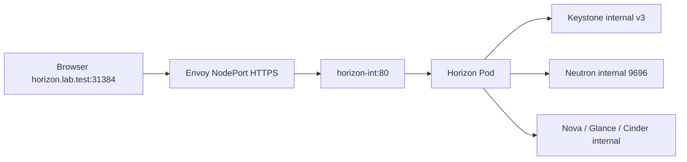

# 01. Cụm mình đang có: đọc từ dưới lên

| Phần | Vai trò | Bạn đụng tới nó khi nào? |
|---|---|---|
| Bastion Ubuntu | Chạy talosctl/kubectl/Helm, lưu file | Sửa chart/values, render, gửi lệnh tới cluster |
| controlplane-01 .137 | Kubernetes control plane và nhiều service | Machine config, scheduling, storage |
| workerplane-01 .139 | Compute/KVM và disk Ceph | Libvirt, OVS, Nova compute, Rook |
| Talos | OS node, không SSH/apt như Ubuntu | Dùng talosctl và machine config |
| Kubernetes | Lưu tài nguyên, điều khiển pod/Service | kubectl get/apply/describe/logs |
| Helm | Chart + values thành tài nguyên | template/upgrade/get/history |
| Genestack | Repo cấu hình, workflow và công cụ | Học cách quy hoạch; không phải daemon tự chạy trên node |

## 1. Request dashboard đi đâu?



TLS kết thúc tại Envoy. Horizon nhận HTTP phía sau proxy, dùng forwarded header để hiểu client đi HTTPS. HTTPRoute chọn backend; không tự sửa Keystone catalog. Catalog là danh sách URL Horizon/CLI dùng để tìm API.

## 2. File Horizon của mình

| File trên bastion | Ý nghĩa |
|---|---|
| charts/horizon/Chart.yaml | Tên/version chart; khác version ứng dụng |
| charts/horizon/values.yaml | Defaults |
| charts/horizon/templates/ | Mẫu Deployment/Job/Secret/Service |
| overrides/horizon/2026.1-ubuntu_noble.yaml | Image/distro overrides |
| gateway-api/horizon/https-values.yaml | Cấu hình cuối HTTPS/CSRF theo NodePort và endpoint_type=internalURL |
| config/overrides/horizon/https-final.yaml trong folder học | Bản cuối đã gộp; chỉnh hostname/origin theo môi trường |
| gateway-api/horizon/current-before-interface.yaml | Snapshot riêng của một lần sửa, có thể chứa credentials; không là nguồn cố định |
| gateway-api/horizon/internal-endpoint-rendered.yaml | Output xem trước; không phải input chính |

Tất cả đường dẫn trên dưới `~/osh-lab`. File before/current không tự đồng bộ với cluster. Chart/template/config local là nguồn mong muốn; tài nguyên cluster là trạng thái thực tế. Patch trực tiếp Deployment có thể chưa được ghi về file.

## 3. Vì sao nhiều file làm bạn thấy loạn?

Triển khai và debug để lại nhánh VXLAN, shared OVN, migration RabbitMQ, HTTPS. Cần phân biệt bản cuối có chủ đích, snapshot, render và nhánh đã bỏ. Không gộp mọi YAML rồi apply: Helm values, Kubernetes manifest và Talos config có cú pháp/mục đích khác nhau.

```bash
# Chỉ đọc: context, node, release, workload và storage
kubectl config current-context
kubectl get nodes -o wide
helm list -A
kubectl -n openstack get deployments,statefulsets,daemonsets
kubectl -n openstack get svc,pvc
```

helm list không liệt kê mọi tài nguyên: RabbitmqCluster/HTTPRoute tạo bằng kubectl vẫn tồn tại. Deployment/StatefulSet/DaemonSet duy trì pod; pod không phải nơi lưu cấu hình lâu dài.
